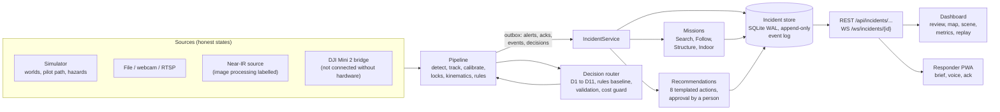

# Architecture

Overwatch has two layers. The **pipeline** turns video, telemetry and phone data into tracks, positions,
kinematics and alerts; [docs/architecture.md](docs/architecture.md) describes it, along with its threads and
locks. The **incident layer**, added in this build, keeps a persistent, replayable record of an incident and runs
the missions, recommendations and the responder link on top of it.

## Incident layer

| Piece | Where | What it guarantees |
|---|---|---|
| Models | `backend/overwatch/incident/models.py` | UTC-only timestamps. Named frames (`wgs84`, `enu:<incident>`, `camera:`, `image:`, `arkit:`, `scene:`) with explicit transforms; mixing frames raises `FrameMismatch`. Provenance is one of live, replay, simulated or manual. |
| Store | `incident/store.py` | Raw observations separate from reviews (latest review wins); one append-only event log with sequence numbers, fanned out to the WebSocket. |
| Replay | `incident/replay.py` | `rebuild(events)` reconstructs the records from the log alone; metrics recomputed from it equal the live values (tested). |
| Metrics | `incident/metrics.py` | Each metric names its source; localization error appears only where ground truth exists. |
| Geo | `incident/geo.py` | Haversine, bearing, ENU and WGS84 through the incident origin, ground projection only through a valid calibration; otherwise `UnsupportedGeolocation`. |
| Briefing | `incident/briefing.py` | Range and bearing only from grounded positions; clock directions only with a trusted heading; a real GPS fix is never placed in a simulated incident. |
| Scene | `incident/scene.py` | Assets live in their own frame. Overlays from other frames go through a valid transform chain, or the overlay names what is missing. |
| Service | `incident/service.py` | Mirrors the pipeline outbox (pipeline alert ids are namespaced per session), persists tracks, runs missions, logs sensor status and operator commands, and handles proposals and approvals. |

## Missions

- **Search** (`missions/search.py`): one candidate per confirmed person track; re-sightings within the combined
  uncertainty are grouped, never merged without positions.
- **Follow** (`missions/follow.py`): only a person designates. Lock re-bindings show as unverified, and motion
  statistics come only from verified positions of the confirmed target.
- **Structure** (`missions/structure.py`): buildings from map data, side A set by the operator, B to D clockwise.
  The simulator fixture proposes openings and is labelled as a fixture.
- **Indoor:** prior scans in the Scene viewer with room labels in the scan's frame.

## Decisions

`decisions/tasks.py` defines typed questions, each with a rules baseline: D1 to D5 (pipeline) and D6 to D11
(worlds). `decisions/router.py` handles every call in this order:

1. Remove unsafe or unsupported options.
2. Use the rules when only one option is left.
3. Ask the engine under a deadline, with a fallback chain.
4. Validate the answer and its probabilities.
5. Apply the confidence gate.
6. Drop stale answers and answers from earlier sessions.
7. Enforce the per-session call and token budget.

The rules answer is recorded on every call. `decisions/recommendations.py` limits all software output to eight
templated MissionActions; anything with an effect waits for a person's approval.

## Simulator

- `sim/driver.py` renders drone frames (OpenCV) from a world. That is the training field, or a scenario's own world
  from `sim/worlds/` (pursuit, sar, flood, fire).
- A scenario can add a scripted pilot path (manual flight) and hazard layers (`sim/hazards/`: water, fire,
  smoke). Hazards are drawn per pixel through the camera's ground intersection.
- Ground truth is used only by the evaluators (`evaluation/gt_eval.py`, `sim/worlds/scoring.py`) and the labelled
  simulated thermal (`sim/sensors/thermal.py`); the pipeline never reads it.
- Aircraft profiles (`sim/aircraft.py`) record where every value comes from; Dryden wind and the energy battery
  (`sim/wind.py`) are opt-in.

## Frontend

`dashboard/` is React 19, Vite 7, Tailwind 4, zustand and three.js.

- `/` is the mission page: left rail (mission and world), center (drone view, 3D world, scene viewer), right rail
  (map, review queue, recommendations, Follow and Structure panels, brief, alerts), bottom (timeline, audit,
  source health with the near-IR preview, metrics, calibration).
- `/responder` is the mobile PWA.
- `/ops` is the original pipeline console.

## Verification

- `make test`: pytest and `tsc`.
- `make eval`: every simulator scenario against ground truth.
- `make bench-incident`: labelled simulated incident benchmark.
- `scripts/worlds_decisions_report.py`: D6 to D11, engine versus rules.
- `scripts/e2e_demo.py`: the demo in headless Chrome, run twice.
