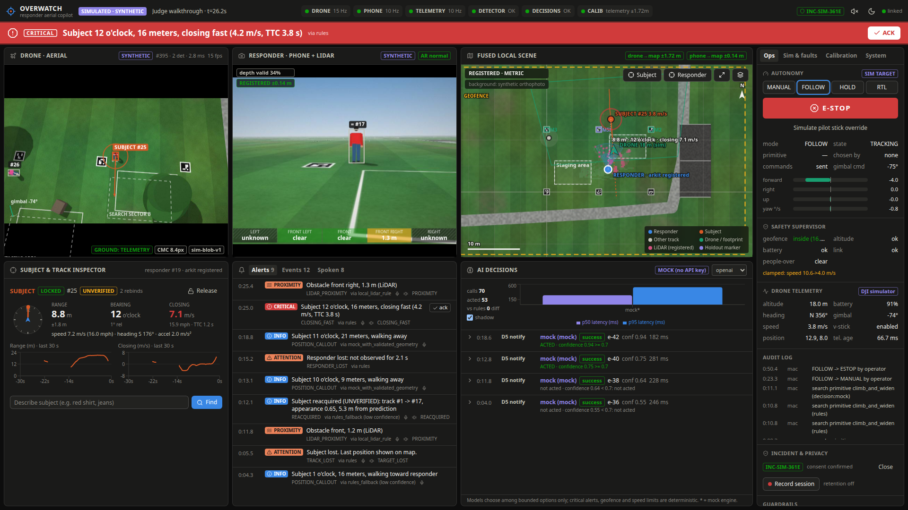
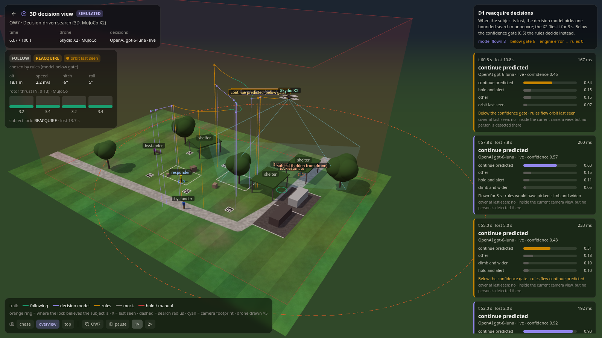

# Overwatch — first-responder aerial copilot

**Drone V1:** current drone setup, manual/automatic movement controls, person-matching details and teammate setup are in [DRONE_V1_HANDOFF.md](DRONE_V1_HANDOFF.md).

A drone's overhead view and a responder's phone (camera + LiDAR) fused into one calibrated local map, with a
human-selected subject kept in view and responder-relative alerts spoken and buzzed on the body:
*"Subject 2 o'clock, 12 meters, closing 3 meters per second."* Every metric claim is gated on calibration and data
freshness, and every number on screen says whether it is live, recorded or synthetic.

Built for HackTX 2026 from two plans (Overwatch + Rescue Copilot); the merged design is in
[docs/IMPLEMENTATION_PLAN.md](docs/IMPLEMENTATION_PLAN.md).



## Incident command (this build)

The mission page at `/` (the original console moved to `/ops`) runs an incident end to end:

- **Missions:** Search, Follow, Structure and Indoor.
- **Persistent, replayable record:** a SQLite store with an append-only event log; metrics are recomputed from the
  log.
- **Recommendations:** eight templated recommendations. Model proposals are validated, and anything with an
  effect waits for a person's approval.
- **Responder PWA:** real-time briefs with voice and acknowledgment.
- **Scene viewer:** meshes, point clouds and Gaussian splats, with frame-checked overlays.
- **Four simulation worlds:** pursuit, search and rescue, flood, fire. They have hazard screening models and
  labelled simulated thermal.

Start here:

- [docs/DRONE_LIVE_INTEGRATION.md](docs/DRONE_LIVE_INTEGRATION.md): live JPEG/H.264 feed, YOLO and OpenAI Decisions control with pilot override.
- [DEMO_RUNBOOK.md](DEMO_RUNBOOK.md): the walkthrough.
- [ARCHITECTURE.md](ARCHITECTURE.md): how it fits together.
- [LIMITATIONS.md](LIMITATIONS.md): what not to trust.
- [IMPLEMENTATION_STATUS.md](IMPLEMENTATION_STATUS.md): what was built, phase by phase, with test results.
- [HARDWARE_INTEGRATION.md](HARDWARE_INTEGRATION.md): the DJI Mini 2, video sources, near-IR, the iPhone and
  AirPods.

## What it does

* **Fused local scene**: drone detections projected to a metric map through ArUco ground markers (with held-out
  marker error), camera-motion chaining, or telemetry ray projection, whichever is valid; the responder's ARKit
  track registered onto the same map; LiDAR obstacles on top.
* **Subject lock**: the operator clicks a person (or describes them and confirms). Re-acquisition after occlusion
  uses a session-only clothing-colour gallery, never switches identity when unsure, and labels rebinds UNVERIFIED.
* **Responder-relative alerts**: range, clock bearing, closing speed and time-to-contact from kinematics only;
  critical alerts never wait for a model. The phone's own LiDAR warns about close obstacles with no network.
* **Decision layer**: OpenAI Decisions (primary), TypeSafe Jev and a local Strands server make bounded, typed choices
  (reacquire strategy, identity confirmation, description matching, motion label, which non-urgent alert to speak)
  with deadlines, confidence gates and a deterministic rules fallback.
* **Autonomy**: IBVS follow, reacquire search primitives and a safety supervisor (geofence, altitude, speed, battery,
  watchdogs). Simulator and DJI simulator only unless `autonomy.allow_real_flight: true`; the pilot always overrides.
* **Honest degradation**: drone video lost, phone offline, internet down, calibration lost — each changes what the
  UI claims, visibly.
* **3D decision view** (`/3d`): a Skydio X2 rigid-body quadrotor (MuJoCo Menagerie, the jev-drone setup) flown by
  the autonomy stack while OpenAI Decisions picks each search manoeuvre, shown with probabilities, latency and
  whether the answer was flown or handed to the rules.
* **Replay and evaluation**: record a session, replay it through the same pipeline, and score 38 simulator
  scenarios against ground truth (27 on the training field plus 11 in the four worlds).



## How the drone is autonomous, end to end

Three loops at three rates, each owned by deterministic code. Models only choose among options code generated and
the safety supervisor already filtered; the rules baseline runs on every call and is the fallback.

| Loop | Rate | Owner | Job |
|---|---|---|---|
| Reflex | 20 Hz | `AutonomyController` + `SafetySupervisor` (`autonomy/controller.py`, `autonomy/safety.py`) | IBVS keeps the subject centred, with feed-forward from the subject's ground velocity. Clamps: 4 m/s horizontal while following, 6 m/s while reacquiring, 45 deg/s yaw, 1.5 m/s vertical; geofence, altitude floor and ceiling, battery, never over people. The bridge's watchdogs hover when no command arrives for 300 ms and hand the aircraft back to the pilot when the link is lost for 2 s |
| Tactical | 5 Hz belief, D12 every 2 s | street-graph belief (`autonomy/belief.py`), viewpoint scoring (`autonomy/pursuit.py`), D1, D12, D13 | Where to look when the subject is lost, which viewpoint and route, which command the operator meant. Bounded choices with a rules baseline and a confidence gate |
| Mission | event-driven | `missions/*`, `decisions/recommendations.py`, `voice/commands.py`, crew routing, people | Search, Follow, Structure, Indoor; typed proposals; a person approves anything with an effect |

**Routing from a belief, not a point.** When the followed subject is lost, 500 particles per identity hypothesis
spread along the street map from where they vanished (turns: straight 0.6, left and right 0.18, reverse 0.04, more
likely under trees or roofs, less likely towards the drone; people stop and hide under cover). Where the camera
looks and sees nobody, particles lose weight. A person seen after the loss who looks like the subject and could have
got there becomes a second hypothesis; an operator's "look for red shirt, jeans" is parsed into clothing words and
reweights the hypotheses, and that is the only way operator text reaches routing. Candidate viewpoints are the
streets holding more than 2% of the belief and the three busiest intersections, scored by the belief mass the camera
could actually see from there before the planning horizon, minus flight time and safety penalties (the supervisor
removes unsafe ones). The route is the shortest safe path along the streets; D12 picks among the top three with the
best score as its baseline, and re-plans every 2 s. The route reasoning card on `/` and `/dashboard` shows all of it.

**Voice commands** (`voice/commands.py`, `voice/grounding.py`, task D13): a transcript (browser speech-to-text or
typed, provenance `manual`) becomes one verb from a closed set (the keyword grammar is the baseline and default
engine; below 0.7 or unclear, it asks). Places and people are grounded against named map entities; two plausible
ones are always a question. Primitives: FOLLOW (a person approves, always), SEARCH and GOTO (a person approves for a
real aircraft), FIND (sets the description on the belief), HOLD and RTL (immediate, no model). ORBIT and LOOK are
recognised and declined in this build.

**Crew routing** (`missions/crew_routing.py`): ground crews are routed live by time-dependent Dijkstra, judging each
road or cell at the moment the crew would reach it (closed above 0.3 m of water; keep out where the fire arrives
within the margin; smoke costs extra), re-planned every 2 s and drawn on the map and in 3D.

**Live flight (DJI Mini 2, MSDK 4.16.2).** Virtual stick in Body-frame velocity mode, where positive pitch moves
right and positive roll moves forward: everything speaks `(forward, right, up, yaw_rate)` and maps through the single
`to_dji` wrapper (`autonomy/vstick.py`, unit-tested). The bridge sends at 20 Hz, re-applies the control modes after a
reconnect (they reset), and treats the pilot's stick input leaving virtual stick as the override. Autonomy in the air
is off by default (`autonomy.allow_real_flight: false`); a person turns it on per session.

## Status: what is real and what is simulated

| Piece | State |
|---|---|
| Backend pipeline, dashboard, `/responder` web page | working end to end in the simulator and with `scripts/fake_devices.py` over the real device protocols |
| Native iOS apps (`ios/`) | responder + DJI bridge written (~6,000 lines Swift); **not compiled yet** (built on Linux) — see the VERIFY list in [ios/README.md](ios/README.md) |
| Drone + real video | not tested with hardware; the bridge app or any OpenCV-readable stream (`OVERWATCH_DRONE_URL`) plugs in |
| Decision engines | **OpenAI Decisions verified live** (p50 ~185 ms; designed cases and scenario S16 in the loop); TypeSafe Jev and Strands not run |
| Voice | ElevenLabs verified live with automatic account fallback (the second key is rejected by ElevenLabs); browser / iOS speech otherwise |
| Detector accuracy on real footage | **not measured**; needs labelled recordings |

## Quick start (no hardware, no keys)

```bash
make setup                 # Python 3.12 venv (uv) + backend deps, dashboard deps
make build                 # build the dashboard; the backend serves it
make backend               # SIMULATED mode, judge demo scenario, http://localhost:8000
```

Open `http://localhost:8000` for the **simulation demo**: every simulation one click away, the drone's camera or the
3D world, a map and plain-language status. **Start here** loads PP0, where a person runs and the drone follows on its
own. **PP8** dispatches the drone from the station's launchpad: type who to look for in clothing words, it takes off,
flies search legs, matches the people its detector finds, tracks the match and reports where they are from the pad.
**People (simulator)** lets you drive any simulated person (send them to a map point, or steer with the arrow keys)
while the drone follows. **PJ1** and **PJ2** fly the same pursuits low with the jev-drone stack (MuJoCo Skydio X2,
range-sector reflex, D6 maneuvers). **CT1** is a police chase downtown: the drone launches from the base, finds the
described person and follows while you drive them from a phone: the demo page opens a Cloudflare tunnel and shows a QR code, the phone page is a
joystick; the towers hide them at every corner. The full incident-command dashboard (review queue, structure, calibration, decisions, replay) is at
`http://localhost:8000/dashboard`, the sensor and fault console at `/ops`, and the responder app at
`http://<mac-ip>:8000/responder` on a phone. `http://localhost:8000/3d` → **OW7** shows the decision API flying the MuJoCo
X2 in 3D (`uv pip install --python backend/.venv/bin/python mujoco`). Optional extras: `uv pip install --python backend/.venv/bin/python
ultralytics av` for YOLO26 and H.264 decoding.

**Tiger Data.** With `TIGER_DATABASE_URL` set (a Tiger Cloud / TimescaleDB service), the incident log, the drone's
telemetry and every confirmed detection are mirrored into hypertables, with continuous aggregates per 10 s and per
minute and compression after a day; the demo page's **Live metrics · Tiger Data** panel reads those rollups. SQLite
stays the system of record; the mirror is best effort and queues while the service is unreachable.

## Plugging in keys and hardware

Copy `.env.example` to `.env`. Keys stay on the Mac; nothing is shipped to the phones or the browser.

| Key / device | Unlocks |
|---|---|
| `OPENAI_API_KEY` | OpenAI Decisions as the primary decision engine |
| `TYPESAFE_API_KEY` | TypeSafe Jev (shadow comparison by default) |
| `STRANDS_URL` | local Strands Decider (offline fallback) |
| `ELEVENLABS_API_KEY`, `ELEVENLABS_API_KEY2`, `ELEVENLABS_ACCOUNT` | TTS with automatic fallback between accounts (browser/iOS speech works without them) |
| `GEMINI_API_KEY` | optional situation summaries |
| `OVERWATCH_TOKEN` | required token on device sockets and control endpoints when exposed beyond the LAN |
| DJI Mini 2 + RC-N1 + iPhone | `ios/OverwatchDroneBridge` (needs a DJI App Key), or your own stream via `OVERWATCH_DRONE_URL` |
| LiDAR iPhone | `ios/OverwatchResponder` |

`make backend-live` switches to live sources. The order of operations (incident + consent, markers, mark the
responder, lock the subject) is in [docs/operating_guide.md](docs/operating_guide.md). Calibrate the drone camera and
lay surveyed markers first: [docs/calibration.md](docs/calibration.md).

## Testing and evaluation

```bash
make test             # 192 backend tests (1 skipped: needs DJI recordings) + dashboard typecheck
make eval             # 38 simulator scenarios -> evaluation/reports/<stamp>/summary.md
make e2e              # the demo in headless Chrome, twice, outcomes compared (needs a dashboard build)
make bench-incident   # SIMULATED incident benchmark: scripted operator and responder, metrics from the log
make bench-decisions  # decision engines on designed cases (NOT RUN without keys)
```

Latest full run (synthetic, seed 0): 38 scenarios. Every one of the 28 with a pass criterion passes (17 on the
training field, 11 in the four worlds); 10 more are measurement-only. The end-to-end demo passed twice with
identical outcomes. Per-phase results are in [IMPLEMENTATION_STATUS.md](IMPLEMENTATION_STATUS.md).

| Scenario | Result | Numbers |
|---|---|---|
| demo Judge walkthrough | PASS | lock correct 1.00, range err p50 0.55 m, events at TRACK_LOST 4.53 s, LIDAR_PROXIMITY 11.83 s, CLOSING_FAST 25.03 s |
| S05 Actor temporarily occluded | PASS | recall 0.995 (0.876 before the symmetric-IoU tracker fix); lost 4.53 s, reacquired 11.43 s |
| S16 Decision model vs fixed rules | PASS | 6 conflicts logged; seeded mock in this suite; OpenAI in the loop: 6/6 (docs/decision_engines.md) |
| OW4 Similar people cross (ID-swap trap) | measurement | subject lock correct 1.0 while visible. After the subject leaves the view, the lock re-binds to the look-alike, labelled UNVERIFIED; Follow never confirms it |
| PP2 Pursuit: subject under a carport | PASS | lost at 13.8 s, reacquired at 21.8 s, never on another person |
| SR2 Search: decoys along the sweep | PASS | lost person found; exactly the 2 planted decoys become candidates |
| SR3 Search: person under canopy | PASS | not seen by the camera; the sector keeps probability 0.205 after the sweep |
| FR2 Flood: crew route | PASS | route at 0.28 m of water; the 0.37 m route is removed before any engine is asked |
| FF2 Fire: smoke and an occupant | PASS | all 6 openings under smoke read "unclear"; occupant found; nothing declared safe |

These validate geometry, tracking logic, alerts and fallbacks on simulator imagery. They are not detector accuracy on
real video. Definitions and the full tables: [docs/evaluation.md](docs/evaluation.md).

## Guardrails

No face recognition or cross-session identity; a human selects the subject; locks need an incident with consent;
no intent or threat labels; rules own safety; real-flight autonomy off by default; no crowd monitoring; nothing is
recorded unless an operator starts it; no images to cloud models by default. Details:
[docs/privacy_guardrails.md](docs/privacy_guardrails.md).

## Repository

```
backend/overwatch/   FastAPI app + pipeline: sim, sources, vision, geometry, tracking, events, decisions,
                     autonomy, voice, replay, evaluation
backend/scripts/     run_scenarios, benchmark_models, benchmark_decisions, fake_devices, make_markers, export_schemas
backend/tests/       unit + integration tests
dashboard/           React 19 + Vite + Tailwind console and /responder page
ios/                 OverwatchResponder (ARKit/LiDAR) and OverwatchDroneBridge (DJI MSDK 4)
backend/third_party/ Skydio X2 model from MuJoCo Menagerie (Apache-2.0)
config/              default.yaml, tabletop.yaml (expo station)
schemas/             JSON Schemas of every wire message
docs/                plan, architecture, contracts, calibration, operating guide, guardrails, decision engines,
                     evaluation, demo script
```

Docs: [architecture](docs/architecture.md) · [wire contracts](docs/contracts.md) ·
[decision engines](docs/decision_engines.md) · [judge demo script](docs/demo_script.md)

## HackTX rules

Both source plans note that HackTX expects project code to be written during the event. Check with the organizers
before relying on code written before the hacking window.
