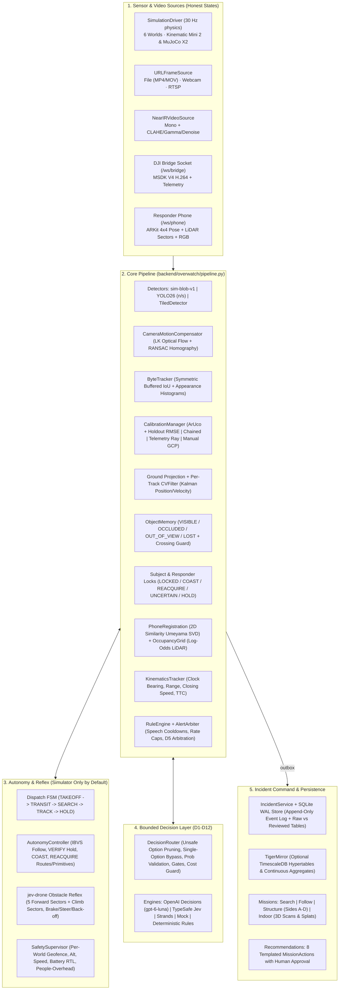

# Overwatch: Complete Functionality & Architecture Audit ()

This document provides an exhaustive technical audit of the **Overwatch** repository (`main` at `a945754` and `feat/fire-water-3d` in `/home/surya/repos/txhack_hazards_3d`), covering every subsystem, how each layer works end to end, what 3D models and 3D renderers exist and how they operate, all 48 simulator scenarios across 6 worlds, the 12 decision tasks, autonomy and dispatch stacks, data stores, APIs, and hardware boundaries.

---

## 1. Executive Summary

- **Codebase Scale:**
  - **Backend (`backend/overwatch/`):** ~21,500 lines of Python across 118 modules (FastAPI, OpenCV, NumPy, SciPy, MuJoCo, Ultralytics YOLO26, SQLite WAL, optional TimescaleDB/Tiger Data mirror).
  - **Frontend (`dashboard/src/`):** ~9,600 lines of TypeScript/React 19 across 43 modules (Vite 7, Tailwind, Three.js, `@mkkellogg/gaussian-splats-3d`, Lucide icons).
  - **Native iOS (`ios/`):** ~6,000 lines of Swift (`OverwatchResponder` ARKit/LiDAR app and `OverwatchDroneBridge` DJI Mobile SDK 4.16.2 app; written, not compiled on Linux).
- **Automated Verification Status:**
  - **Backend unit & integration suite:** 215+ tests passing, 1 skipped (`test_aircraft_fit.py` awaiting real DJI hardware step recordings).
  - **Scenario evaluation suite (`make eval`):** 48 total scenarios (27 field/sensor/pipeline scenarios + 21 world scenarios across 6 worlds). All scenarios with pass criteria pass.
  - **End-to-end browser verification (`make e2e`):** Headless Chrome Playwright suite walks the full incident lifecycle twice on fresh backends and verifies identical outcomes.

---

## 2. System Architecture & End-to-End Execution Graph

### How the Runtime Loop Works (`backend/overwatch/runtime.py`)
1. **Clock Discipline (`clock.py`):**
   - In `SIMULATED` and `REPLAY` modes, the entire system runs on `SimClock` (`t_ms` driven by simulation steps), so pausing, running at $2\times$/$4\times$, or frame-stepping is exact and deterministic.
   - In `LIVE` mode, the system runs on `WallClock`.
2. **Simulation Step (`_sim_step` at 30 Hz):**
   - Advances all `Actor` state machines (scripted waypoints, wander bounds, or live phone joystick commands from `/drive`).
   - Steps the active drone physics model (`SimDrone` first-order kinematic model or `MujocoDrone` 250 Hz rigid-body Skydio X2).
   - Emits synthetic drone video frames at 15 FPS (`SceneRenderer` + `_hazard_overlay`), phone ARKit/LiDAR packets at 10 Hz (`PhoneSim`), and telemetry packets at 10 Hz (`SimBridge`).
   - Runs `OperatorEmulator` for scripted actions (`lock_responder`, `lock_subject`, `operator_watch`, `look_for`, `dispatch`).
   - Runs `pipeline.autonomy_tick(t)` at 20 Hz and `pipeline.tick(t)` at 10 Hz.
3. **Asynchronous Fan-out (`_publish_loop`, `_video_loop`):**
   - Publishes `WorldState` at 10 Hz (`state_hub`), low-rate `extras` at 2 Hz, binary length-prefixed `FrameOverlay + JPEG` packets (`video_hubs["drone" | "phone"]`), and mirrors alerts, acknowledgments, tracks, object memory events, and decisions into `IncidentService` (SQLite) and `TigerMirror` (TimescaleDB).

---

## 3. All 3D Models, 3D Renderers & 3D Views (Detailed Breakdown)

The repository has **three distinct 3D subsystems** that work together:
1. **The Live 3D World & Decision View (`dashboard/src/lib/sim3d.ts`, `/3d`, and the `3D world` tab on `/` and `/dashboard`)**
2. **The 3D Scene & Reconstruction Viewer (`dashboard/src/components/mission/SceneViewer.tsx` and `backend/overwatch/incident/scene.py`)**
3. **The Backend 3D Software Pinhole Renderer & Physics Models (`backend/overwatch/sim/render.py` and `mujoco_drone.py`)**

### 3.1 Live 3D Simulator World (`dashboard/src/lib/sim3d.ts`, `SceneController`)
Rendered with **Three.js (`WebGLRenderer` + `CSS2DRenderer`)** and streamed at 20 Hz over `WS /ws/sim3d` (`backend/overwatch/api/sim3d.py`). Coordinate conversion maps backend local ENU metres $(x_{\text{east}}, y_{\text{north}}, z_{\text{up}})$ to Three.js y-up $(x, z, -y)$ via `v3(x, y, z) = new THREE.Vector3(x, z, -y)`.

| 3D Model / Visual Element | How It Is Built & Animated | Status |
|---|---|---|
| **Skydio X2 Quadrotor Mesh** | Loaded via `OBJLoader` from `backend/third_party/skydio_x2/assets/X2_lowpoly.obj` with `X2_lowpoly_texture_SpinningProps_1024.png` (MuJoCo Menagerie, Apache-2.0). Rotated each frame by `C_ENU * q_body` where `q_body` comes either from MuJoCo's exact rigid-body quaternion (`d.data.qpos[3:7]`) or ZYX Euler angles from the kinematic model. Includes a fallback cross mesh before the OBJ finishes loading and a green ground-projection ring directly underneath the aircraft. | **Working** |
| **Articulated 3D Human Figures (`person` & `animatePerson`)** | Every simulated person (`subject`, `responder`, `bystander`) is procedurally constructed in Three.js as a hierarchical 15-part jointed rig scaled by `height / 1.75`: • **Legs:** Left/right `hip` groups → `thigh` cylinders → `knee` groups → `shin` cylinders (skin-colored if `shorts`, pants-colored if `long`) → `foot` boxes. • **Torso:** Lower and upper flattened cylinders (`scale.z = 0.62`), optional open `jacket` with inner `shirt` chest strip, high-vis `vest` (#d9e021), and 3D `backpack` box. • **Arms:** Left/right `shoulder` groups → `upperArm` cylinders → `elbow` groups → `fore` cylinders (skin if short-sleeved) → spherical `hand`. • **Head:** `neck` cylinder, `head` sphere, hemispherical `hair` cap, and optional two-piece `hat` (brim + crown). • **Animation:** `animatePerson()` swings `hip`, `knee`, `shoulder`, and `elbow` joints sinusoidally with `a.phase` and amplitude scaled by `a.speed`. | **Working** |
| **Static World Geometry (Buildings, Houses, Towers, Shelters, Vehicles, Trees)** | • **Boxes (`w.boxes`):** `BoxGeometry` positioned at `(center_x, center_y, z0 + H/2)` and rotated by `heading`. Includes suburban houses, carports/pergolas, fences, parked cars, supply crates, launchpad slabs (`pad` + `H` markings + `hangar`), and downtown skyscrapers (12–48 m tall in `city.py`). • **Building Openings (`b.openings`):** Doors, windows, garage doors, and stairs rendered as 3D `PlaneGeometry` decals offset $5\text{ cm}$ along the wall's outward normal. • **Trees (`w.trees`):** `CylinderGeometry` trunk + 4 overlapping `SphereGeometry` canopy lobes. In the 1.5 km SAR forest (~15,900 trees), `/api/sim3d/world` sends the 3,000 trees nearest the drone. • **Ground & Geofence:** Synthetic world orthophoto (`/api/world/ortho.jpg?w=<world>`) mapped onto the ground plane with a surrounding apron, dashed zone polygons, and translucent 30 m tall red geofence walls. | **Working** |
| **Camera Footprint, Flight Trail & Decision Pins** | • **Camera Footprint:** Real-time raycast polygon (`footFill` translucent cyan mesh + 4 corner `footRays` lines from the drone camera). • **Flight Trail:** 6,000-vertex `THREE.Line` colored per segment by who controlled the drone (`#199e70` tracking, `#9085e9` AI decision model, `#c98500` deterministic rules, `#898781` mock, `#d03b3b` hold/manual). • **Pipeline Belief vs. Ground Truth:** Orange ring (`subjEst`) at the pipeline's Kalman estimate, orange `X` at `last_seen_xy`, dashed `search_radius` circle, and vertical 3D lollipop pins (`decision_marks`) at the exact $(x, y, z)$ where each `D1_reacquire` decision took effect. | **Working** |
| **3D Flood Water Visualization (`feat/fire-water-3d`)** | • **Animated Water Grid Mesh:** 3D heightfield surface over `whz.grid` (`125 × 125` vertices at 4 m spacing) whose height `z = level(t) - ground_m` rises with the flood model, animated with a 60 FPS sine wave (`0.025 * sin(2.4*t + ...)`), vertex-colored from cyan-blue shallow water (`< 0.3 m`) to deep flood blue (`>= 0.3 m`). • **Polygon Water Surfaces & Contours:** Filled translucent `ShapeGeometry` meshes for `water` ($\ge 0.05\text{ m}$) and `deep_water` ($\ge 0.30\text{ m}$), plus solid cyan shoreline outlines and dashed orange deep-water contours. • **Closed Roads & Barricades:** Road edges with water $> 0.3\text{ m}$ are highlighted in red with cylindrical barricade posts and a 3D label (`road closed · 1.13 m water (>0.3 m)`). • **Safe Crew Route (`D9`):** Rendered as a 3D green `TubeGeometry` spline (`CatmullRomCurve3`) with endpoint spheres and a 3D label (`crew route · 112 m (max 0.00 m water)`). | **Working** (in worktree `feat/fire-water-3d`) |
| **3D Fire & Volumetric Smoke Visualization (`feat/fire-water-3d`)** | • **Ground Burn Scar & Keep-Out Mesh:** Dynamic 3D ground surface over `whz.grid` (`100 × 100` cells at 2 m spacing) plus filled `ShapeGeometry` overlays showing the active flame front (bright orange-yellow, `age <= 7 s`), glowing ember interior (`age > 7 s`), and 2-minute keep-out warning zone (`arrival <= t + margin`). • **Instanced 3D Flickering Flames (`flameInst`):** `THREE.InstancedMesh` of 280 `ConeGeometry` flames with `AdditiveBlending` and HSL fire colors placed along active burning cells, flickering at 60 FPS and leaning along the wind vector, paired with a dynamic orange `THREE.PointLight`. • **Instanced 3D Volumetric Smoke Plume (`smokeInst`):** `THREE.InstancedMesh` of 96 `IcosahedronGeometry` puffs billowing upward from `smoke_source_xy` and drifting downwind along `wind_to_deg` with $18^\circ$ Gaussian lateral dispersion. • **Structure Openings & Crew Route:** Colored 3D rings on all 6 building openings (`#22c55e` crew target door, `#f59e0b` unclear under smoke, `#ff4d4f` inside keep-out) and a 3D green `TubeGeometry` walking route from staging to the nearest door outside keep-out. | **Working** (in worktree `feat/fire-water-3d`) |

### 3.2 3D Scene & Indoor Reconstruction Viewer (`dashboard/src/components/mission/SceneViewer.tsx`)
Used in **Indoor** mission mode (and accessible via the `Scene` tab in `/dashboard`):
- **Supported 3D Asset Formats (`backend/overwatch/incident/scene.py`):**
  1. **3D Gaussian Splats (`.ply`, `.splat`, `.ksplat`):** Validated by checking PLY vertex properties (`f_dc_0`, `opacity`, `scale_0`, `rot_0`) or binary `.splat`/`.ksplat` headers. Rendered via `@mkkellogg/gaussian-splats-3d` (`DropInViewer`). If WebGL splat sorting fails, automatically falls back to rendering the Gaussian centers as a `THREE.Points` point cloud.
  2. **Point Clouds (`.ply`, `.obj` without faces):** Loaded via `PLYLoader` or `OBJLoader` into `THREE.Points` with vertex colors.
  3. **Triangle Meshes (`.ply` with faces, `.obj` with faces):** Loaded with computed vertex normals into `THREE.Mesh` with `MeshStandardMaterial`.
- **Built-in Generators:**
  - `POST /api/incidents/{id}/scene/sim-export`: Exports the simulator's current building and supply geometry as a colored ASCII PLY point cloud in the incident's `enu:<id>` frame with an identity transform (explicitly badged `SIMULATED · not a reconstruction`).
  - `POST /api/incidents/{id}/scene/sample-indoor`: Generates a 34,870-point synthetic 3-room + corridor indoor scan PLY in `arkit:<id>` frame (explicitly badged `SYNTHETIC` and initially unaligned).
- **Frame-Checked 3D Overlays (`scene.overlay` & `scene.resolve`):**
  - Resolves up to 3 hops of valid `Transform` matrices (and their matrix inverses) between `enu:<incident>`, `scene:<id>`, and `arkit:<id>`.
  - Refuses to project incident observations onto an unaligned scan and names the unaligned frames in the UI.
  - Allows operators to raycast-click on the 3D scan to place `room` labels or enter manual `[yaw, east, north]` alignment transforms.

### 3.3 Backend Software 3D Pinhole Renderer & MuJoCo Physics (`sim/render.py`, `sim/mujoco_drone.py`)
- **`SceneRenderer` (`backend/overwatch/sim/render.py`):**
  - Renders synthetic $960 \times 540$ drone RGB frames and $640 \times 480$ responder phone frames + 5-sector LiDAR depth using the exact same `PinholeCamera` intrinsics/extrinsics that the perception pipeline uses.
  - Warps multi-resolution ground mipmaps (`levels[0..2]`) via perspective homography, projects sun shadows onto the ground, culls static objects by camera footprint, batch-projects tree canopies, draws 3D box faces with Lambertian sun shading and Sutherland-Hodgman near-plane clipping (`_clip_near`), and draws the 15-part articulated human figures into both the RGB buffer and an integer `id_mask` buffer.
  - Computes exact pixel-level ground-truth visibility (`vis_n / area`) and bounding boxes from `id_mask` for evaluation.
- **`MujocoDrone` (`backend/overwatch/sim/mujoco_drone.py`):**
  - Runs the Skydio X2 rigid-body model (`backend/third_party/skydio_x2/overwatch_scene.xml`) at 250 Hz (`PHYS_DT = 0.004 s`) using a geometric $SO(3)$ attitude controller (Lee et al. 2010) and actuator allocation matrix $A^{-1}$ with yaw headroom prioritization so rotor saturation never sacrifices roll/pitch stability.

---

## 4. Six Simulation Worlds & All 48 Scenarios

### 4.1 World Catalog

| World ID | Module | Dimensions | Geometry & Features | Scenarios |
|---|---|---|---|---|
| `training-field` | `sim/world.py`, `sim/worlds/training.py` | $65 \times 44\text{ m}$ | Surveyed ArUco markers (`M0`–`M5`), cars, crates, trees, shelters; `DEMO-1` adds a 4-sided building (`Side A`–`D` openings) and supply cache | `demo`, `DEMO-1`, `S01`–`S17`, `S20`, `OW1`–`OW7` (27 scenarios) |
| `pursuit` | `sim/worlds/pursuit.py` | $400 \times 300\text{ m}$ | $3 \times 3$ street grid (street graph used as map data), 153 buildings/carports/fences/cars, 37 street trees, station launchpad at $(-135, -120)$ | `PP0`–`PP8`, `PJ1`, `PJ2` (11 scenarios) |
| `city` | `sim/worlds/city.py` | $400 \times 400\text{ m}$ | $5 \times 5$ downtown street grid, ~45 towers ($12\text{ m}$ to $48\text{ m}$ tall that occlude line of sight), central plaza, police base launchpad at $(-172, -172)$ | `CT1`, `CT2` (2 scenarios) |
| `sar` | `sim/worlds/sar.py` | $1.5 \times 1.5\text{ km}$ | ~15,920 trees, 45 clearings, trail, creek, $3 \times 3$ search sectors (`S1`–`S9`, $500\text{ m}$ each) with Bayesian POA prior, trailhead launchpad | `SR1`–`SR4` (4 scenarios) |
| `flood` | `sim/worlds/flood.py` | $500 \times 500\text{ m}$ | 215 houses, road elevation graph, bathtub flood model $h(t)$ rising from $0.15\text{ m}$ to $1.10\text{ m}$, road closure threshold $> 0.30\text{ m}$ | `FR1`, `FR2` (2 scenarios) |
| `fire` | `sim/worlds/fire.py` | $200 \times 200\text{ m}$ | Two-storey house with 6 openings on Sides A–D, fire engine, 70 trees, shortest-path elliptical wind fire spread model, 2-min keep-out zone, Gaussian smoke plume | `FF1`, `FF2` (2 scenarios) |

### 4.2 Scenario Groups & How Each Works
- **Core Pipeline & Sensor Scenarios (`demo`, `DEMO-1`, `S01`–`S20`, `OW1`–`OW7`):**
  - Test nadir/oblique projection (`S01`, `S02`), approach & fast-closing alerts (`S03`, `OW1`, `OW5`, `OW6`), field-of-view exit (`S04`), tree/shelter occlusion & re-acquisition (`S05`, `OW2`, `OW7`), camera wobble & CMC (`S06`), gimbal pan calibration invalidation (`S07`), low light & blur (`S08`), high-altitude small targets (`S09`), offline phone LiDAR proximity (`S10`–`S12`), portrait/landscape phone rotation (`S13`), unaligned cameras (`S14`), cloud API timeouts/429s/refusals (`S15`), D5 alert priority conflicts (`S16`), source dropouts (`S17`), dense 8-person crowds (`S20`), high-speed IBVS follow (`OW3`), and red-shirt look-alike crossing traps (`OW4`).
- **Pursuit & Low-Altitude `jev-drone` Scenarios (`PP0`–`PP8`, `PJ1`, `PJ2`):**
  - `PP0`, `PP8`: Autonomous launchpad dispatch (`TAKEOFF` → `TRANSIT` → lawnmower `SEARCH` → clothing-color match → `FOLLOW` + pad-relative position reports).
  - `PP1`–`PP4`: Sidewalk follow, carport occlusion, look-alike crossing, street-tree canopy run.
  - `PP5`–`PP7`: Autonomous pursuit with `VERIFY` camera-only hold on unverified re-bindings, `D12` street-map routing when lost, and operator `"look for"` clothing input.
  - `PJ1`, `PJ2`: Low-altitude ($7\text{ m}$) pursuit with the MuJoCo Skydio X2 (`stack="jev-x2"`), using the 5-sector forward obstacle reflex (`autonomy/reflex.py`) and `D6` obstacle avoidance around street trees and pergola roofs with 0 collisions.
- **Downtown City Chase & Phone Target Controller (`CT1`, `CT2`):**
  - `CT1`: Launches from the base pad, matches the target in `"red shirt, jeans"`, and follows them through downtown towers. Anyone can scan a QR code on `/` (via the built-in Cloudflare quick tunnel `/api/tunnel/start`) to open `/drive` on their phone and steer the target around skyscrapers with a virtual joystick.
  - `CT2`: Scripted multi-corner evasion behind 40 m towers exercising `D12` street-graph search when towers block line of sight.
- **Search & Rescue (`SR1`–`SR4`):**
  - Lawnmower sector sweeps updating Bayesian Probability of Area (`SR1` clearing find, `SR2` red jacket + orange tarp decoys queued for human review, `SR3` person under dense canopy where sector probability remains $0.205$ rather than falsely claiming clear, `SR4` autonomous trailhead dispatch for `"yellow jacket, jeans"`).
- **Flood Rescue (`FR1`, `FR2`) & Firefighter Routing (`FF1`, `FF2`):**
  - `FR1`: Finds 3 stranded people in rising water; `FR2`: Computes crew routes over the road graph, strips routes crossing $> 0.3\text{ m}$ water before any model is called, and selects the safe $0.28\text{ m}$ detour.
  - `FF1`: Computes a $57.7\text{ m}$ walking route from staging to the nearest door outside the 2-minute fire keep-out zone ($0$ keep-out cells crossed); `FF2`: Marks all 6 openings under smoke as `"unclear"` (`D11`), finds the occupant outside, and never declares any opening `"safe"`.

---

## 5. Perception, Geometry, Tracking & Object Memory

1. **Detectors (`vision/detectors.py`):**
   - `sim-blob-v1` (`SimBlobDetector`): HSV saturation/value connected-components detector for synthetic frames (explicitly tagged `valid_on="synthetic"`).
   - `YOLO26` (`UltralyticsDetector`): Runs `yolo26n.pt` or `yolo26s.pt` on real frames (or when overridden).
   - `TiledDetector`: Splits high-altitude frames into overlapping $640\times 640$ tiles with cross-tile NMS for small overhead targets (`S09`).
2. **Camera Motion Compensation (`vision/cmc.py`):**
   - Tracks Shi-Tomasi background corners (masking out detection boxes) with Lucas-Kanade optical flow and fits a RANSAC homography $H$ between consecutive frames.
3. **Tracker (`vision/tracker.py`):**
   - Two-stage `ByteTracker` (high-confidence $\ge 0.50$, low-confidence $\ge 0.15$) with **symmetric buffered IoU** (C-BIoU style: expands both track and detection boxes proportional to time coasted, raising `S05` occlusion recall from $0.876$ to $0.995$) plus HSV torso/legs color histogram appearance similarity (`vision/appearance.py`).
4. **Calibration & Metric Projection (`geometry/calibration.py`, `incident/geo.py`):**
   - Priority hierarchy:
     1. **ArUco Ground Markers (`MARKER_LOCKED`):** $\ge 4$ surveyed markers visible and holdout marker RMSE $\le 0.50\text{ m}$.
     2. **CMC-Chained Homography (`MARKER_CHAINED`):** Composes frame-to-frame $H_{\text{CMC}}$ for up to $6\text{ s}$ with growing uncertainty.
     3. **Operator Ground Control Points (`MANUAL_POINTS`):** $\ge 4$ image-to-map point pairs from the Calibration tab.
     4. **Telemetry Ray-Plane Intersection (`TELEMETRY_ONLY`):** Uses drone altitude, pitch, roll, yaw, and gimbal angle with error bound $\pm 0.06\text{ m/m altitude}$.
     5. **`INVALID`:** When none is valid or drone video is stale, `world_position = null` and the UI displays `"location not yet verified"`.
5. **Object Memory (`tracking/memory.py`):**
   - Maintains persistent ground-frame person records (`P1`, `P2`, ...) across occlusions and tracker ID switches in four states: `VISIBLE`, `OCCLUDED` (tree canopy pixels detected over projected ground spot), `OUT_OF_VIEW` (outside camera frustum), or `LOST` (unexplained absence $> 0.6\text{ s}$).
   - Includes a **crossing guard** (refuses automatic re-attachment if another person is within $2.5\text{ m}$ or runner-up score is close).
6. **Subject & Responder Locks (`tracking/lock.py`):**
   - State machine: `UNLOCKED` → `LOCKED` → `COAST` ($> 0.7\text{ s}$) → `REACQUIRE` ($> 2.0\text{ s}$) → `HOLD` ($> 20\text{ s}$), or `UNCERTAIN` when multiple candidates compete.
   - Automatic re-bindings after occlusion are marked `verified = False` (`UNVERIFIED`) until a human confirms.

---

## 6. Autonomy, Dispatch & Safety Supervisor (`backend/overwatch/autonomy/`)

- **Modes:** `MANUAL`, `FOLLOW`, `DISPATCH`, `HOLD`, `RTL`, `ESTOP`.
- **Follow FSM (`controller.py`):**
  - `TRACKING`: Image-Based Visual Servoing (IBVS) — PID yaw centers the bounding box horizontally, gimbal pitch centers vertically, and forward/right velocity maintains `standoff_m` ($12\text{ m}$) with velocity feed-forward.
  - `VERIFY`: Triggered when the subject lock re-binds without human confirmation. **Zeroes all translational velocity** (`fwd = right = 0`) and only rotates yaw/gimbal to keep the person in view until an operator confirms or re-designates.
  - `COAST` ($< 2\text{ s}$ lost): Holds station and yaws toward predicted position.
  - `REACQUIRE` ($\ge 2\text{ s}$ lost): Flies bounded `D1` search primitives (`continue_predicted`, `yaw_left_scan`, `yaw_right_scan`, `climb_and_widen`, `orbit_last_seen`, `hold_and_alert`) or `D12` street-map pursuit routes (`route:P1`, etc.).
- **Autonomous Launchpad Dispatch (`controller.py`, `pipeline.py`):**
  - Triggered via `POST /api/autonomy/dispatch` with clothing description words (`"red shirt, jeans"`) and `last_seen_xy` / `radius_m`.
  - Phases: `TAKEOFF` (climbs from pad to mission altitude) → `TRANSIT` (flies to search area) → `SEARCH` (flies lawnmower legs, flags every detected person for review, scores clothing colors via `describes()`) → `TRACK` (locks and follows the single clear match, or enters `HOLD` if two people match) and emits pad-relative range/compass reports.
- **Low-Altitude Obstacle Reflex (`autonomy/reflex.py`):**
  - Used by `stack="jev-x2"`. Computes 5 forward range sectors (`left2`, `left1`, `ahead`, `right1`, `right2`) across a $60^\circ$ FOV at the drone's altitude and $3.5\text{ m}$ higher.
  - Deterministically brakes when `path_ahead_m < 6.0 m`, steers toward `wider_side()`, backs off at $-1.0\text{ m/s}$ when `< 2.5 m`, and queries `D6_obstacle` (`sidestep_left`, `sidestep_right`, `climb`, `hold_position`) when `< 8.0 m`.
- **Safety Supervisor (`autonomy/safety.py`):**
  - Enforces per-world polygon geofence (`geofence_margin_m`), altitude floor/ceiling ($12\text{–}60\text{ m}$ or scenario override), speed caps, people-overhead cylinder check, and automatic `RTL` at $\le 20\%$ battery.
  - Real flight is hard-gated off (`autonomy.allow_real_flight = False`).

---

## 7. Bounded Decision Layer (`D1`–`D12`) & Recommendations

Every decision task in `backend/overwatch/decisions/tasks.py` and `router.py` follows a strict 7-step pipeline:
1. `prepare(job)` removes any option with `unsafe != None` before any model or rule sees it.
2. If only 1 option remains, `RulesEngine` answers immediately with zero API calls.
3. `DecisionRouter` queries the primary engine (`OpenAIDecisionsEngine` `gpt-6-luna`, `TypeSafeEngine` `jev-latest`, `StrandsEngine`, `MockEngine`, or `RulesEngine`) under an $800\text{ ms}$ deadline with fallback chain. Note: `decisions.pursuit_engine` defaults to `"rules"` so routine `D1`/`D4`/`D12` follow ticks do not burn API tokens unless set to `"model"`.
4. Validates that the selected choice is in `valid_values` and that probabilities are in $[0, 1]$, sum to $1.0 \pm 0.05$, and rank the selected option first.
5. Applies task-specific confidence gates (`0.70` default, `0.75` for `D2`/`D3` identity/description, `0.50` for `D1`).
6. Drops stale answers (`> 1.5 s` old or from an earlier session epoch).
7. Enforces per-session call (`2,000`) and token (`400,000`) cost guards and logs the deterministic rules baseline (`_rules_baseline`) on every call.

| Task | Question | Used Where |
|---|---|---|
| `D1_reacquire` | Bounded search maneuver after losing subject (`continue_predicted`, `yaw_left_scan`, `yaw_right_scan`, `climb_and_widen`, `orbit_last_seen`, `hold_and_alert`) | Live pipeline (`FOLLOW` when no street graph) & `/3d` (`OW7`) |
| `D2_identity` | Which candidate track continues an interrupted track | Live pipeline when `subj.state == "UNCERTAIN"` |
| `D3_describe` | Which visible track matches operator clothing words | `POST /api/locks/describe` & Follow panel |
| `D4_motion` | Observable kinematic motion label (`stationary`, `walking`, `jogging_or_running`, `approaching_responder`, `moving_away`, `crossing`) | Live pipeline (every $1.5\text{ s}$ while locked) |
| `D5_priority` | Most useful non-urgent notification to speak next | `AlertArbiter` when multiple informational events queue |
| `D6_obstacle` | Low-altitude obstacle maneuver (`hold_position`, `sidestep_left`, `sidestep_right`, `climb`) | `jev-x2` stack (`PJ1`, `PJ2`) & world benchmarks |
| `D7_lead_triage` | Which unreviewed Search candidate to review first | SAR / Flood world evaluation & benchmarks |
| `D8_next_sector` | Next search sector from Bayesian POA posterior, coverage, and distance | SAR world (`SR1`–`SR3`) |
| `D9_route` | Ground crew route among code-computed paths (unsafe water $> 0.3\text{ m}$ removed first) | Flood world (`FR1`, `FR2`) |
| `D10_dispatch` | Crew-to-request assignment proposal | Flood world (`FR1`, `FR2`) |
| `D11_opening` | Visible condition at a building opening (`obstruction_marked`, `obstruction_seen`, `no_obstruction_seen`, `unclear`; blind/smoke options removed by code; never `"safe"`) | Fire world (`FF1`, `FF2`) & Structure mode |
| `D12_pursuit_route` | Street-graph pursuit route when subject is lost (`street` ahead, intersection branches, `orbit`, or `sighting` matching `"look for"` words) | Pursuit & City worlds (`PP5`–`PP7`, `CT1`, `CT2`) |

### Eight Templated Recommendations (`decisions/recommendations.py`)
`review_candidate`, `inspect_area`, `mark_last_seen`, `request_operator_confirmation`, `notify_responder`, `show_structure_side`, `hold_for_more_information`, and `return_to_operator_review`. Model proposals are checked against flight-control forbidden words and invented numbers before being queued for human approval.

---

## 8. Persistence, Replay & External Integrations

- **SQLite Store (`backend/overwatch/incident/store.py`):**
  - Tables: `incidents`, `sensor_sources`, `observations` (raw detector output), `observation_reviews` (human reviews, kept separate so raw data is never mutated), `tracks`, `scene_anchors`, `scene_assets`, `transforms`, `alerts`, `mission_actions`, `incident_events` (append-only log with monotonic `seq`).
  - Deterministic log rebuild (`incident/replay.py`): Re-running `rebuild()` over `incident_events` reproduces the exact incident state and metrics (`incident/metrics.py`).
- **Tiger Data / TimescaleDB Mirror (`backend/overwatch/incident/tiger.py`):**
  - When `TIGER_DATABASE_URL` is set in `.env`, a background thread batches `ow_events`, `ow_telemetry`, and `ow_detections` into TimescaleDB hypertables with continuous aggregates (`ow_events_1m`, `ow_telemetry_10s`, `ow_detections_10s`) and 1-day compression policies, exposed at `GET /api/tiger` and `GET /api/incidents/{id}/tiger/metrics`.
- **Cloudflare Quick Tunnel (`backend/overwatch/api/tunnel.py`):**
  - `POST /api/tunnel/start` spawns `cloudflared tunnel --url http://localhost:8000` and parses the `https://*.trycloudflare.com` URL so the Demo page (`/`) renders a live QR code for `<tunnel-url>/drive`.
- **Voice & Narration (`backend/overwatch/voice/`):**
  - `ElevenLabsTTS` (`tts.py`): Multi-account fallback across `ELEVENLABS_API_KEY`..`5` with preferred account selection (`ELEVENLABS_ACCOUNT`), plus browser `speechSynthesis` fallback on `/responder`.
  - `GeminiNarrator` (`gemini.py`): Optional periodic situation summaries (`template` narrator by default).

---

## 9. Frontend Applications (`dashboard/src/`)

| Route | Component | Functionality |
|---|---|---|
| `/` | `pages/Demo.tsx` | **Simulation Demo:** One-click scenario launcher (`Start here` loads `PP0`), Drone Camera / 3D World tabs, Dispatch by clothing description card, Target Movement controls + Cloudflare QR code for `/drive`, plain-English "Now playing" status, 2D FusedMap, and live event feed. |
| `/dashboard` | `pages/Mission.tsx` | **Full Incident Command Console:** • `LeftRail`: Mission mode (`Search`, `Follow`, `Structure`, `Indoor`), World/Scenario picker, Sensor states, Video source switcher. • `CenterView`: Drone video with click-to-select/flag/designate + Simulated Thermal inset (`Sim thermal`), `3D world` (`Scene3DPanel`), and `Scene` (`SceneViewer`). • `RightRail`: `FusedMap` (orthophoto, hazard polygons, tracks, trails, uncertainty rings, pursuit routes, object memory ghosts, manual pins), Review Queue with evidence modal, Follow panel (`who to follow`, `look for`), Structure panel (Side A–D), Recommendations approval queue, Responder Brief, Alerts. • `BottomPanel`: Scrubbable Timeline Replay, Audit Log, Source Health + Near-IR side-by-side enhancement preview, Metrics, Ground-Point Calibration. |
| `/3d` | `pages/Sim3D.tsx` | **Full-Screen 3D Decision & Hazard View:** Three.js world with `chase` / `overview` / `top` camera modes, Skydio X2 mesh & rotor thrust bars, articulated people, camera footprint, colored flight trail, `D1` decision cards & 3D pins, and (in `feat/fire-water-3d`) 3D flood water, closed roads, 3D flames, volumetric smoke plume, and safe crew routes (`OW7`, `FR1`, `FR2`, `FF1`, `FF2` quick-switch buttons). |
| `/drive` | `pages/Drive.tsx` | **Mobile Target Controller:** Touch joystick + speed selector (`walk`, `jog`, `run`, `sprint`) that drives any simulated person (`POST /api/simulation/people/{id}`) at 4 Hz with a $0.6\text{ s}$ dead-man lease. |
| `/responder` | `pages/Responder.tsx` | **Responder PWA:** Mobile-first incident alert receiver (`WS /ws/incidents/{id}`) with Web Speech synthesis, vibration / screen flash, one-tap `ACKNOWLEDGE`, and grounded range/clock bearings (`GET /api/incidents/{id}/responder-brief`). |
| `/responder/sensors` | `pages/ResponderSensors.tsx` | **Phone Sensor Proximity View:** LiDAR sector arcs and local obstacle alert HUD. |
| `/ops` (`/ops/drone`, `/ops/phone`, `/ops/map`) | `pages/Console.tsx`, `pages/ViewPage.tsx` | **Sensor, Fusion & Fault-Injection Console:** Original engineering console with live fault toggles (`drone_video_drop`, `phone_drop`, `wobble`, `low_light`, `blur`, `wind_gust`, `api_timeout`, etc.) and decision engine switcher. |

---

## 10. Current Status: What Works vs. Known Limitations

### Fully Working & Verified
- **All 6 simulation worlds and 48 scenarios** run deterministically and pass their evaluation criteria.
- **3D models and 3D views:**
  - Skydio X2 3D OBJ mesh + texture with rigid-body MuJoCo physics (`OW7`, `PJ1`, `PJ2`) and kinematic flight.
  - 15-part articulated, animated 3D human figures with clothing, jackets, vests, backpacks, hats, and walking/running limb swing.
  - 3D buildings with wall openings (doors, windows, garage doors, stairs), downtown towers, shelters, launchpads, vehicles, and view-culled trees.
  - 3D Scene Viewer for PLY/OBJ meshes, point clouds, and 3D Gaussian Splats (`GaussianSplats3D`) with coordinate-frame-checked overlays.
  - **In worktree `/home/surya/repos/txhack_hazards_3d` (`feat/fire-water-3d`):** Full 3D flood water surface with wave ripples, depth shading, shoreline/deep contours, closed-road barricades, 3D flickering fire front cones, 3D volumetric downwind smoke plume, and 3D spline crew routes.

### Known Nuances & Hardware Boundaries
1. **Main branch vs. `feat/fire-water-3d` worktree:**
   - The 3D fire, smoke, and flood water visualizations are implemented and verified in the `/home/surya/repos/txhack_hazards_3d` worktree (`feat/fire-water-3d` branch) and can be merged into `main` whenever desired.
2. **Pursuit routing (`D12`) in `PP5`–`PP7`:**
   - `PP5`, `PP6`, and `PP7` share the same initial subject trajectory before occlusion, so the deterministic rules / mock engine pick `P1` (continue along street) in all three. In `CT2` (downtown city chase), the tall towers force multiple line-of-sight losses around corners where `D12` street-graph routing actively searches branches.
3. **Hardware-Dependent Items (Untested on Physical Hardware):**
   - Native iOS apps (`ios/OverwatchResponder` and `ios/OverwatchDroneBridge`) are written in Swift but require Xcode on macOS and physical iPhone + DJI Mini 2 hardware to compile and flight-test.
   - Real-footage YOLO detector accuracy benchmarks and COLMAP/splatfacto GPU training scripts (`scripts/reconstruction/`) require field recordings and a CUDA GPU.
