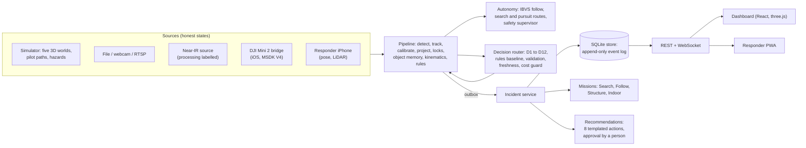

# Overwatch: project overview

Status as of : the 18 planned phases (0 to 17) are built and committed, plus one extension (larger worlds
and object memory). Autonomous pursuit with decision-engine routing is being finished. Measured results are in
[IMPLEMENTATION_STATUS.md](../IMPLEMENTATION_STATUS.md); limits are in [LIMITATIONS.md](../LIMITATIONS.md).

## 1. The idea

First responders searching for a person, following someone through a neighbourhood, or sizing up a building from
the outside need two things at once: an overhead view, and someone on the ground who knows where to go. Overwatch
connects a drone's video, an incident commander's dashboard and a responder's phone into one incident:

- **The drone sees.** Video goes through detection and tracking. People become candidates on a map with an
  honest position uncertainty, and only when the camera's ground calibration supports a position.
- **The operator decides.** Every candidate is reviewed by a person. Software proposes; a person approves anything
  that has an effect (sending a brief, flying a route, re-identifying someone).
- **The responder acts.** A phone app receives the confirmed brief by voice ("possible person, 11 o'clock, about 18
  metres, plus or minus 3"), vibrates, and the responder acknowledges.
- **Everything is recorded.** One append-only event log per incident can rebuild the whole incident and its
  metrics.

Four mission modes cover the situations from the brief:

| Mode | What it does |
|---|---|
| **Search** | Flags possible people once per person (not per frame), groups re-sightings, queues them for review; never declares an area clear |
| **Follow** | Tracks a person an operator designated: trail, lost marking, no identity switch without a person, autonomous pursuit in the simulator |
| **Structure** | Organises a building's openings by side A to D (A set by the operator); never says an entry is safe |
| **Indoor** | Shows a prior 3D scan (mesh, point cloud or Gaussian splat) with room labels |

### Principles the code enforces

- **Honest provenance.** Every record and screen says live, replay, simulated or manual. Nothing simulated is
  shown as real, and no hardware link is faked: the DJI source says "not connected" until a real bridge talks.
- **No invented numbers.** Positions need a valid calibration. Messages are templates filled only from computed
  fields. Metrics are recomputed from the log and name their source.
- **People decide.**
  - Real flight stays manual (`autonomy.allow_real_flight` is false).
  - No model output reaches flight control.
  - Identity never switches without a person.
- **No surveillance features.** No facial recognition, no identity beyond "the track the operator designated", no
  intent or threat labels.
- **Labelled models.** Near-IR is not thermal. Simulated thermal, fire, smoke and flood models are labelled
  simulations and screening models.

## 2. Architecture



### Layers

| Layer | Where | What it does |
|---|---|---|
| Sources | `backend/overwatch/sources/`, `sim/` | One interface over the simulator, file, webcam, RTSP, near-IR and the DJI bridge, each with an honest connection state |
| Pipeline | `pipeline.py`, `vision/`, `geometry/`, `tracking/` | Detection (simulator detector, optional YOLO), image tracker (symmetric buffered IoU), ground calibration (markers, telemetry, operator points), world filters, subject and responder locks, object memory, kinematics, alert rules |
| Autonomy | `autonomy/` | Follow by visual servoing; search primitives; pursuit routes on a street map; coverage paths; dispatch (take off from the pad, fly search legs, hand over to Follow on a description match, report the position relative to the pad); the low-altitude jev-drone stack (`reflex.py`: range sectors, a reflex that keeps the veto, D6 maneuvers); a safety supervisor (geofence, altitude, speed, battery, people overhead). Follow-mode decisions go to the rules unless `decisions.pursuit_engine: model`. Commands reach only the simulator unless real flight is enabled (it is not) |
| Decisions | `decisions/` | Typed questions D1 to D12, a rules baseline on every call, engines (OpenAI Decisions, Jev, a local model, a labelled mock), validation, freshness, session counter, confidence gates, cost guard |
| Incident layer | `incident/`, `missions/` | Incident records, named coordinate frames and transforms, the event log, metrics, briefing, scenes, missions, recommendations |
| API | `api/` | REST `/api/incidents/...`, WebSocket `/ws/incidents/{id}`, video and state sockets |
| Dashboard | `dashboard/` | Simulation demo (`/`), full mission dashboard (`/dashboard`), responder PWA (`/responder`), original console (`/ops`), 3D decision view (`/3d`) |
| Evaluation | `evaluation/`, `scripts/` | Scenario runner scored against simulator ground truth, benchmarks, the end-to-end browser test |

### Data model and frames

- **Records:** incident, sensor source, observation (raw, kept separate from reviews), review, track, scene
  anchor, transform, alert, mission action, event.
- **Timestamps** are UTC only.
- **Frames are named:** `wgs84`, `enu:<incident>`, `camera:`, `image:`, `arkit:`, `scene:`. Moving between frames
  needs an explicit, valid transform; mixing frames raises an error.
- **Provenance** is one of live, replay, simulated or manual.

### Decisions

The pipeline asks bounded, typed questions. Each call goes through these steps:

1. Code removes unsafe or unsupported options.
2. If one option is left, the rules answer and no model is called.
3. The engine is asked under a deadline, with a fallback chain.
4. The answer and its probabilities are validated.
5. The confidence gate applies.
6. Stale answers and answers from earlier sessions are dropped.
7. A per-session call and token budget applies.

The rules answer is recorded on every call, so "model versus rules" is measured, not asserted. Without a key the
system runs rules-only and says so.

| Task | Question |
|---|---|
| D1 | Search manoeuvre after a loss |
| D2 | Which candidate continues an interrupted track |
| D3 | Which candidate matches the operator's description |
| D4 | Motion label |
| D5 | Which alert to speak |
| D6 | Obstacle manoeuvre |
| D7 | Lead triage |
| D8 | Next search sector |
| D9 | Crew route |
| D10 | Dispatch proposal |
| D11 | Opening condition |
| D12 | Pursuit route on the street map |

## 3. What is implemented

### Phases 0 to 17 (all committed)

| Phase | Delivered |
|---|---|
| 0 | Environment check and baseline (69 tests, 26 scenarios, 17 of 17 pass criteria) |
| 1 | Incident data model, frames and transforms, SQLite store with raw observations separate from reviews |
| 2 | Incident REST API and WebSocket stream; pipeline alerts, acks and decisions mirrored into the store |
| 3 | Scene spec and the guaranteed demo world DEMO-1 (building with sides A to D, blocked garage, supply cache, volunteer, responder); replay determinism |
| 4 | Video source manager: simulated, file, webcam, RTSP, DJI Mini 2 bridge, near-IR; honest states; media timestamps; reconnect counts |
| 5 | Dark mission dashboard: mission and world, drone view, 3D world, map, review queue, alerts, timeline replay, audit, health, metrics |
| 6 | Responder PWA: incident join, real-time briefs, speech, vibration, acknowledgment, grounded bearings |
| 7 | Detection and tracking hardening. Tracker fix: recall on S05 rose from 0.876 to 0.995 |
| 8 | Search auto-flagging with re-sighting groups; Structure sides A to D |
| 9 | Geo helpers (haversine, bearing, ENU/WGS84), calibration panel with image-to-map ground points |
| 10 | Eight templated recommendations with approval; model proposals validated; router hygiene; D6 to D11 |
| 11 | Every event kind logged; metrics rebuilt from the log equal the live values; localization error only with ground truth; incident benchmark |
| 12 | Scene viewer for meshes, point clouds and Gaussian splats; overlays only through valid transforms; Indoor room labels; reconstruction scripts (not run: no GPU) |
| 13 | Follow mode: operator-only designation, trail, lost marking, unverified re-binds, motion statistics from verified positions |
| 14 | Four worlds (pursuit, search and rescue, flood, fire); hazard screening models (water, fire, smoke); probability of area; coverage paths; simulated thermal; 11 world scenarios; seed-paired D6 to D11 reports with the real engine |
| 15 | Aircraft profiles with the source of every value, Dryden wind, energy battery, step-response harness |
| 16 | Near-IR source with labelled enhancement and a raw-versus-processed preview; never a temperature |
| 17 | Headless-Chrome end-to-end demo run twice with identical outcomes; runbook, architecture, limitations, hardware docs |

Bugs found and fixed along the way:

- The live server dropped identity, description and motion decisions (D2 to D4).
- A model answered "no obstruction seen" for openings under smoke and was acted on.
- The decisions API rejects a question with one option left.
- The map kept one orthophoto for every world.
- The scene viewer kept the previous incident's scene.
- A scenario switch kept the old incident.
- Distance travelled was counted from position jitter.

### Extension E1: larger worlds and object memory (committed)

- **Worlds at plan size:**
  - Pursuit: 400 by 300 m, with a street grid that serves as map data.
  - Search and rescue: 1.5 by 1.5 km, about 15,900 trees.
  - Flood: 500 by 500 m.
  - Fire: 200 by 200 m.

  View culling and cached tree geometry took the search world from 2.2 s to 0.2 s per frame. All 11 world
  scenarios still pass.
- **Object memory** (`tracking/memory.py`): ideas from Permanence (Knight Hacks IX), reimplemented because that
  repository has no licence.
  - Every person keeps a persistent id through occlusion and tracker id switches, in one of four states: VISIBLE,
    OCCLUDED, OUT_OF_VIEW or LOST, with confidence fading while hidden.
  - A new track is attached only when it is the single plausible match and nobody else is nearby.
  - Search flags one candidate per remembered person. The map and the video show hidden people.
  - Measured: fewer ids per person in 5 of 8 occlusion scenarios (for example PP2: tracker 2, memory 1), with 0
    wrong merges by the memory.

### Extension E2: autonomous pursuit (built, being finished)

- **Geofence:** each world's own fence. Before this, the training field's fence applied everywhere.
- **Hold when unverified:** autonomy never moves towards a re-identification nobody confirmed. It holds and keeps
  the camera on the person until an operator confirms or re-designates.
- **D12 pursuit routing:** when the subject is lost, code computes routes on the street map from the subject's
  last observed motion: along the street, each branch at the next intersection, circling the last-seen spot, and
  the last sighting of a remembered person matching the operator's "look for" words. The decision engine (or the
  rules) picks one, and the drone flies it as a bounded route.
- **Operator inputs:** "who to follow" (describe, then confirm) and "look for" (clothing words that weigh routing).
- **Scenarios** PP5 to PP7 (sprint and turn, a look-alike after a loss, a look-for request) all pass with the mock
  engine. The subject was lost at 31.7 s and found again 3.5 s later, and the drone never tracked the look-alike.

## 4. Running and checking it

```bash
make setup
```

```bash
cd dashboard && npm run build
```

```bash
make backend
```

Open http://localhost:8000 (or `make dashboard` for the dev server on :5188) for the simulation demo and pick a
simulation; **Start here** loads PP0, a person running with the drone following; **PP8** is a dispatch from the
launchpad (search by description, track, report); **PJ1** flies low with the jev-drone stack. The full dashboard is
at `/dashboard`.
[DEMO_RUNBOOK.md](../DEMO_RUNBOOK.md) walks through the demo and each world.

| Check | Command |
|---|---|
| Backend tests and dashboard type-check | `make test` |
| Every simulator scenario against ground truth | `make eval` (quick set: `make eval-quick`) |
| The demo in headless Chrome, twice | `make e2e` |
| Labelled simulated incident benchmark | `make bench-incident` |
| D6 to D12 versus rules | `backend/scripts/worlds_decisions_report.py --engine openai` |

## 5. Simulated, hardware-dependent, not built

- **Simulated** (and labelled as such): the five worlds and their people, hazards, simulated thermal, the
  structure-opening fixture, the synthetic indoor scan, the mock decision engine.
- **Needs hardware, not tested here:**
  - The DJI Mini 2 through the iOS bridge.
  - The iPhone responder on a real phone (speech, AirPods, GPS heading).
  - Near-IR footage.
  - DJI simulator step recordings (the fit test skips until they exist).
- **Not built:**
  - 23 of the 34 planned world scenarios (the rest are listed in the dashboard).
  - Terrain relief, an OpenStreetMap import, glTF world assets.
  - Open-vocabulary door detection.
  - Reconstruction runs (GPU).
  - Native iOS LiDAR export, ESP32 haptics.

## 6. Where to read more

| Document | What it covers |
|---|---|
| [README.md](../README.md) | Quick start, test numbers |
| [ARCHITECTURE.md](../ARCHITECTURE.md) | The incident layer in detail |
| [docs/architecture.md](architecture.md) | The pipeline, threads and locks |
| [IMPLEMENTATION_STATUS.md](../IMPLEMENTATION_STATUS.md) | Every phase with its gate results and the final report |
| [LIMITATIONS.md](../LIMITATIONS.md) | What not to trust |
| [HARDWARE_INTEGRATION.md](../HARDWARE_INTEGRATION.md) | DJI Mini 2, video sources, near-IR, iPhone and AirPods, drone model fitting |
| [DEMO_RUNBOOK.md](../DEMO_RUNBOOK.md) | The demo walkthrough |
| [docs/WORLDS_AND_DASHBOARD_PLAN.md](WORLDS_AND_DASHBOARD_PLAN.md) | The plan these phases followed |
