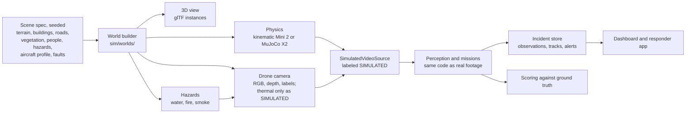

# Overwatch build plan: one sequential run

 · version 2. This version merges the hackathon brief (`message.txt`) with the plan for the four
3D worlds, the mission dashboard, drone accuracy and the decisions API.

## How to run this plan

The plan executes **in one go, phase after phase**. A phase starts only when the previous phase's gate is green.
Every phase builds, tests and commits before moving on, so the demo is runnable after every phase.

**The loop for every phase**

1. Implement the phase's todos, reusing existing code before writing new code.
2. **Build:** `make build` (dashboard type check and production build).
3. **Test:** `make test` (backend unit and integration tests plus the dashboard type check), plus the phase's own new
   tests.
4. **Scenarios:** `make eval-quick` (demo and Overwatch scenarios). Phases that touch the simulator also run
   `make eval` (all scenarios).
5. **Look:** open the changed screens in the browser at 1440 px and 768 px (and an iPhone-sized viewport for the
   responder app), and click every new control to confirm it changes backend state.
6. **Record:** update `IMPLEMENTATION_STATUS.md` with what changed and the actual test output.
7. **Commit** with a message naming the phase.

**Rules while running**

- A red gate is fixed inside the phase. Never start the next phase on a red gate, and never leave a half-built
  feature that breaks the demo.
- Priorities: **P0** is the reliable end-to-end demo on a laptop and an iPhone with replayed or simulated data and
  honest provenance labels. **P1** is real RGB computer vision, the mission modes, real responder notifications,
  optional drone video and mapping. **P2** is 3D Gaussian splatting, iPhone LiDAR import, near-IR input, the four
  large simulation worlds and drone-model fitting. **P3** is not built (section 13).
- The phases are ordered P0, then P1, then P2. If time runs out, stop feature work, run phase 17 (stabilize and
  hand off), and report.
- Never claim a test passed without running it. Never invent benchmarks, connections, coordinates or safety
  conclusions.
- The final report sorts everything into: implemented and tested; implemented but not tested; simulated;
  hardware-dependent; not implemented.

## Contents

1. [Environment](#1-environment)
2. [Where we start](#2-where-we-start)
3. [Hardware truths and safety limits](#3-hardware-truths-and-safety-limits)
4. [Mission packs and the four situations](#4-mission-packs-and-the-four-situations)
5. [Data model and coordinate frames](#5-data-model-and-coordinate-frames)
6. [API and event stream](#6-api-and-event-stream)
7. [The dashboard](#7-the-dashboard)
8. [The four 3D worlds](#8-the-four-3d-worlds)
9. [Drone simulation accuracy](#9-drone-simulation-accuracy)
10. [Decisions: deterministic first, the decisions API used properly](#10-decisions-deterministic-first-the-decisions-api-used-properly)
11. [What we reuse from each repo](#11-what-we-reuse-from-each-repo)
12. [Execution phases](#12-execution-phases)
13. [Not built (P3)](#13-not-built-p3)
14. [Deliverables](#14-deliverables)
15. [Risks](#15-risks)

## 1. Environment

Measured on the development machine on :

| Item | Value | Consequence |
|---|---|---|
| OS | Linux | No Xcode: the existing Swift apps stay "written, not built here"; the responder path is the web app (PWA) |
| GPU | No NVIDIA GPU (`nvidia-smi` not found) | YOLO runs on CPU; no Gaussian-splat training here, only scripts and docs for a GPU machine |
| CPU, memory | 16 cores, 22 GB | Enough for CPU detection at demo resolution and batch simulation |
| Python | 3.12.14 (backend venv) | Matches the backend |
| Node, npm | 24.20.0, 11.19.0 | Matches the dashboard (Vite 7, React 19) |
| Browser | Google Chrome 156 (headless works) | Browser checks and an end-to-end demo test |

Phase 0 re-checks these and records them in `IMPLEMENTATION_STATUS.md`.

## 2. Where we start

The brief's recommended layout (`apps/`, `services/`, `packages/`) is adapted to the existing repo instead of
rebuilt: the backend stays `backend/overwatch/` and the dashboard stays `dashboard/`.

| Piece | Today | Where |
|---|---|---|
| Backend | FastAPI with REST and WebSockets, auth on mutating routes, `/api/health`, `/api/incident`, tracks, locks, calibration, registration, autonomy, decisions, alerts with acknowledgment, events, metrics, simulation control | `backend/overwatch/api/app.py` |
| Contracts | Pydantic wire contracts with JSON Schema export (`make schemas`) | `schemas.py`, `schemas/` |
| Ingestion | Simulator, recorded-session replay, OpenCV URL source (RTSP, webcam, file), DJI bridge socket, phone socket | `sources/`, `replay/` |
| Perception | YOLO26 or simulated detector, ByteTrack-style tracker with camera-motion compensation, ArUco markers, appearance re-identification | `vision/`, `tracking/` |
| Geometry | Camera model, homography with holdout error, telemetry projection, calibration manager, ARKit registration, occupancy grid, Kalman, kinematics, geo conversions | `geometry/` |
| Decisions | D1 to D5 through OpenAI Decisions, Jev and Strands adapters, rules fallback, gates, shadow comparison | `decisions/` |
| Simulator | One 65 by 44 m field, OpenCV renderer, kinematic Mini 2 stand-in, MuJoCo Skydio X2, 26 scenarios | `sim/` |
| Dashboard | Overview console, `/drone`, `/phone`, `/map`, `/3d`, `/responder` | `dashboard/src/` |
| iOS | Responder app (ARKit and LiDAR) and DJI Mini 2 bridge app (DJI MSDK 4.16.2), written but never run on hardware | `ios/` |
| Tests | 69 backend tests; scenario suite with 17 of 17 pass criteria met (scenario suite report) | `backend/tests/`, `evaluation/` |

Missing compared with the brief: SQLite persistence, the incident-centered data model (observations with review state
and provenance, scene anchors, mission actions), incident-scoped routes, a review queue, Structure and Indoor modes, a
near-IR source, a responder PWA with install and offline support, a scene viewer for scans, and the handoff documents.
The brief's description of earlier results counts as claims until phase 0 re-runs the tests.

## 3. Hardware truths and safety limits

These apply to every phase.

- **DJI Mini 2:** stock RGB camera only. No thermal, no depth, no forward obstacle avoidance, no reliable indoor
  autonomy. DJI Mobile SDK **V4** only (the bridge uses 4.16.2); V5 is not assumed to support it. Compatibility with
  our exact phone and live stream must be verified on hardware.
- **Real flight is manual.** On real hardware, go to, orbit, follow and return are operator suggestions, never
  commands. The pilot keeps full control. No model ever sends flight commands. The existing virtual-stick path stays
  disabled for real flight in the hackathon build (`autonomy.allow_real_flight` remains false).
- **In simulation,** mission primitives may fly the simulated drone. Every such screen and report is labeled
  SIMULATED.
- **iPhone:** a browser cannot read LiDAR depth or ARKit poses; that needs the native app (no Xcode here) or an
  imported scan.
- **AirPods** have no programmable haptics. Audio follows the phone's current output route; haptics come from the
  phone where the browser allows it.
- **Near-IR is not thermal.** No temperature or heat claims from near-IR or enhanced low-light video. Simulated
  thermal exists only inside the simulation worlds and is labeled SIMULATED THERMAL.
- **Follow** on real footage is video analysis of a consenting volunteer. It is not autonomous pursuit. No facial
  recognition, no identity inference, no intent or threat labels.
- **Positions:** a bounding box alone is not a location. World positions are computed only with valid calibration,
  pose and a justified ground-plane assumption; otherwise `world_position = null` and the UI says "location not yet
  verified".
- **No added hardware purchases.** Everything must work with the laptop, the iPhone, AirPods and recorded or
  simulated data.

## 4. Mission packs and the four situations

The brief's four mission packs are the software modes. The four simulation worlds are the situations they are
trained and demonstrated in.

| Mission pack | What it does | Trained in (simulation world) | Real-data path for the hackathon |
|---|---|---|---|
| Search | Flag possible people, group duplicates, queue them for review, place them on the map only when location is supported | Search and rescue world; flood rescue world | Recorded or live Mini 2 video, replay |
| Follow | Track an operator-designated, consenting volunteer; timestamped trail; mark lost on occlusion; never switch identity silently | Police pursuit world | Recorded footage of a volunteer |
| Structure | Manual tags first, then optional detection of doors, windows, stairs, garage doors and openings; organize by side A to D | Firefighter routing world | Recorded orbit footage of a building |
| Indoor | Show a previously scanned room or building in 3D with annotations and room labels; no indoor flight | Scanned or provided models | Imported scan (PLY or OBJ plus a transform file) |

The guaranteed demo (phase 3) uses a small training-area world that contains a bit of each.

## 5. Data model and coordinate frames

New Pydantic models in `backend/overwatch/incident/models.py`, exported to JSON Schema and TypeScript like today's
contracts. All timestamps are timezone-aware UTC.

| Model | Fields |
|---|---|
| Incident | id, title, created_at, status, mission_mode, coordinate_reference, operator_notes |
| SensorSource | id, kind (drone_rgb, ground_rgb, near_ir, lidar, replay, simulation), name, connection_status, source_mode (live, replay, simulated), last_seen_at, calibration |
| Observation | id, incident_id, sensor_source_id, observed_at, received_at, category, label, confidence (only from a calibrated or identified detector), bounding_box, world_position or null, horizontal_uncertainty_m or null, coordinate_frame, position_estimation_method, evidence_frame_reference, review_status (pending, confirmed, rejected), reviewer, review_timestamp, stale_after, provenance (live, replay, simulated, manual) |
| Track | id, incident_id, observation_ids, first_seen, last_seen, ordered positions, tracking_status (active, lost, ended), identity_status (unverified, operator_designated) |
| SceneAnchor | id, incident_id, name, type, coordinate_frame, position, transform metadata, uncertainty, manually_verified |
| Alert | id, incident_id, severity, source_observation_ids, message, created_at, delivered_at, acknowledged_at, status |
| MissionAction | id, mission, action_type, proposed_by (rules, model, human), parameters, approval_status, execution_status, safety_constraints |
| Transform | id, source_frame, target_frame, matrix or parameters, method, residual, created_at, valid_until |

**Frames.** WGS84 (latitude and longitude), local ENU in metres for incident geometry, the camera optical frame for
image measurements, and the ARKit local world frame for iPhone scans. Every conversion goes through an explicit
`Transform` with source and target frame ids. Code that mixes frames without one raises an error.

**Storage.** SQLite (stdlib `sqlite3`, WAL mode) in `backend/overwatch/incident/store.py`:
- raw observations and reviewed annotations live in separate tables;
- an append-only event log holds every change and is enough to replay an incident;
- every displayed observation keeps its provenance.

## 6. API and event stream

Existing routes stay. New incident-scoped routes are added, documented in OpenAPI, with structured errors
(`{"error": {"code", "message", "details"}}`):

| Method and path | Purpose |
|---|---|
| `GET /health` (alias of `/api/health`) | Health, versions, source states |
| `POST /api/incidents`, `GET /api/incidents`, `GET /api/incidents/{id}` | Incident CRUD |
| `POST /api/incidents/{id}/mission` | Switch mission mode (logged) |
| `GET`, `POST /api/incidents/{id}/observations` | List and ingest observations |
| `POST /api/observations/{id}/review` | Confirm or reject, with reviewer and time |
| `GET /api/incidents/{id}/tracks` | Tracks with status |
| `GET /api/incidents/{id}/alerts`, `POST /api/alerts/{id}/acknowledge` | Alerts and acknowledgment |
| `POST /api/incidents/{id}/responder-position` | Responder position and heading with accuracy |
| `GET /api/incidents/{id}/scene`, `POST /api/incidents/{id}/scene/anchors` | Scene model, anchors, transforms |
| `POST /api/incidents/{id}/replay/start`, `.../replay/pause`, `.../replay/seek` | Replay controls |
| `GET /api/incidents/{id}/metrics` | Metrics computed from the event log |
| `GET /api/usecases`, `GET /api/scenarios?usecase=` | Simulation worlds and their scenarios |
| `POST /api/incidents/{id}/sources` | Choose a video source (file, webcam, RTSP, simulated, DJI bridge, near-IR) |
| `WS /ws/incidents/{id}` | Incident events: observations, reviews, tracks, alerts, mission changes, source health, decisions |

Video stays on the existing binary video sockets and MJPEG endpoints, not on the incident event socket.

## 7. The dashboard

A dark, high-contrast incident-command interface. `/` becomes the dashboard; today's console moves to `/ops`;
`/3d` stays. Every control performs a real action.

```text
+-----------------------------------------------------------------------------------------------+
| OVERWATCH  Incident: Training area A  ·  SIMULATED  ·  [Start demo incident]   ws: connected   |
+------------------+----------------------------------------------+-----------------------------+
| MISSION          | DRONE VIEW [Video | 3D world]   SIMULATED    | INCIDENT MAP  layers [v]    |
| (•) Search       | +------------------------------------------+ | +-------------------------+ |
| ( ) Follow       | |  frame with boxes, track IDs, lock;      | | | confirmed (solid pins)  | |
| ( ) Structure    | |  click a box to select or designate      | | | pending (hollow pins)   | |
| ( ) Indoor       | |                                          | | | trail, sides A-D,       | |
|                  | +------------------------------------------+ | | scanned area, hazards   | |
| WORLD / SCENARIO | |<  ||  >|  0:42 / 3:00   speed 1x  seek ---  | +-------------------------+ |
| Training area A  | alt 18 m · battery 74% · gimbal -60°         | REVIEW QUEUE (3 pending)    |
| Police pursuit   |                                              | possible person · 0.81      |
| Search & rescue  |                                              |   [Confirm] [Reject] [Ev.]  |
| Flood rescue     |                                              | ALERTS (1 unacknowledged)   |
| Fire routing     |                                              | STRUCTURE  A | B | C | D    |
|                  |                                              | possible doorway, Side C,   |
| SENSORS          |                                              |   pending review            |
| drone_rgb  sim ● |                                              | [Brief responder]           |
| phone      off ○ |                                              |                             |
| SOURCE [Sim v]   |                                              |                             |
+------------------+----------------------------------------------+-----------------------------+
| TIMELINE --o---o-----x---o--->  | AUDIT LOG | SOURCE HEALTH | METRICS: candidates 7, confirmed |
|                                 |           |               | 2, rejected 3, review median 14 s |
+-----------------------------------------------------------------------------------------------+
```

| Area | Contents | Built from |
|---|---|---|
| Left | Mission selector (Search, Follow, Structure, Indoor); world and scenario selector (training area plus the four situation worlds); connected sensors with live, replay or simulated mode; video source selector; incident metadata | New; sensor states from today's source health |
| Center | Drone view: frame with boxes, confidence (only from a calibrated detector), track IDs, click to select or designate, playback controls, source-mode badge. A toggle swaps in the 3D world view: drone, camera footprint, trail colored by who chose each move, truth versus estimate (simulation only) | `VideoPane`, `overlays.ts`, `lib/sim3d.ts` |
| Right | Incident map with confirmed and pending observations kept visually distinct, selected trail, building-side annotations, scanning layers (scanned area, probability, hazards, routes; simulated thermal only in simulation), review queue with evidence, alerts, Structure side panel, "Brief responder" | `FusedMap`, `AlertsTimeline`, new review queue and layers |
| Bottom | Timeline of events (scrub to replay), audit log, source health, uncertainty, metrics | New, reading the event log |

**Scanning per situation:** pursuit shows the footprint on the subject and the search pattern after a loss. Search
shows sectors, lanes, the scanned area filling in and probability falling. Flood shows lanes, triage pins and water
depth on roads. Fire shows the orbit, openings appearing on the building by side, keep-out zones and routes with their
margins.

**Design rules:** keep the validated palette and tokens; status always has an icon and a word; pending versus
confirmed is shown by shape as well as color; provenance badges (LIVE, REPLAY, SIMULATED, MANUAL) on every
observation; all numbers carry units.

## 8. The four 3D worlds

One seeded **scene spec** per scenario drives the physics, the drone camera, the 3D view, the hazards and the scoring,
so they cannot disagree.



| World | Extent | Contents | Missions | Scenarios |
|---|---|---|---|---|
| Training area (demo) | About 80 by 60 m | One building with at least two doors and openings, one manually marked blocked entrance, one supply location, one volunteer, one responder, ArUco markers for calibration | Search, Structure, Follow, Indoor | DEMO-1 (the guaranteed demo) |
| Police pursuit | About 400 by 300 m | Suburban blocks (procedural or from a stored OpenStreetMap extract), houses, carports as cover, fences, cars, street trees; an evasive subject, look-alikes, pedestrians, officers with simulated phones | Follow | PP1 to PP10 |
| Search and rescue | About 1.5 by 1.5 km | Heightmap terrain, trails, clearings, creek, canopy raster; a lost person with behavior profiles; decoys; ground teams | Search | SR1 to SR8 |
| Flood rescue | About 500 by 500 m | Low-lying neighborhood, rising water h(t), road graph with elevations (closed above 0.3 m depth), stranded people, debris, crews, scripted radio reports | Search, routing | FR1 to FR8 |
| Firefighter routing | About 200 by 200 m | Building with doors, windows, garage, stairs and roof hatch on sides A to D; fire arrival times (ember's shortest-path method); smoke plume; keep-out zones; crews | Structure, routing | FF1 to FF8 |

New modules: `sim/worlds/` (spec, builders, terrain, offline OpenStreetMap import), `sim/behaviors.py` (evasive
subject, pedestrians, lost person, stranded person, crews), `sim/hazards/` (water, fire, smoke), `sim/sensors/thermal.py`
(simulation only), `sim/aircraft.py`, `autonomy/coverage.py`, `geometry/probability.py`.

The drone camera is built in steps. First, extend the OpenCV renderer with terrain, roofs, water, smoke and the
simulated thermal pass. Next, render the same glTF assets offscreen (pyrender or moderngl through EGL, CPU fallback)
so the drone view matches the 3D view. A photoreal tier stays optional.

**Assets:** Kenney packs (CC0), the vendored Skydio X2 (Apache-2.0), OpenStreetMap (ODbL, attributed) and
GaussianSplats3D (MIT) for splats in three.js.

**Honest limits:** fire spread and smoke are fast screening models, labeled as such everywhere.

## 9. Drone simulation accuracy

| Model | Use |
|---|---|
| Kinematic Mini 2 (`drone_dynamics.py`: first-order velocity response, OU-process gusts, bounded GPS random walk, baro drift, battery, gimbal rate limits) | Batch runs and the DJI-shaped path; DJI's own controller closes the loop, so the velocity response to commands is what matters |
| MuJoCo Skydio X2 (`mujoco_drone.py`) | Physics runs: obstacles, wind forces, tilt limits, rotor saturation |

**Aircraft profiles** (`sim/aircraft.py`) hold mass, response time constants and delay, speed and climb limits
(spec sheet first, then Overwatch's caps), Dryden turbulence plus steady wind, an energy-based battery, GPS noise,
camera intrinsics and gimbal limits. Spec-sheet values are marked as such and replaced by measured ones.

**Checks:**
1. Velocity steps recorded in DJI's built-in simulator through the bridge with props off. This is
   hardware-dependent: it needs the Mini 2 and a working bridge.
2. The same steps replayed in the kinematic and MuJoCo models. **Pass:** rise time and steady-state speed within
   15%; root-mean-square velocity error under 0.3 m/s.
3. Later: real hover, step and figure-eight logs; battery drain within 10%.
4. `tests/test_aircraft_fit.py` replays the recorded steps in CI.

## 10. Decisions: deterministic first, the decisions API used properly

**Deterministic layer first.** The allowed software recommendations are: review_candidate, inspect_area,
mark_last_seen, request_operator_confirmation, notify_responder, show_structure_side, hold_for_more_information and
return_to_operator_review. Each one is a `MissionAction` with proposed_by, approval status and safety constraints.
Messages come from deterministic templates, and every number comes from a computed field with units.

**Model proposals.** A model (OpenAI Decisions, Jev, a local model) may propose a recommendation or a simulated
mission primitive. A proposal passes schema validation, mission rules, data-availability checks and, where needed,
human approval before it has any effect. A model may paraphrase structured facts but never produces a measurement.
No model commands motors, pursuit, building entry or emergency actions.

**Rules for every decisions API call:**

| Rule | How |
|---|---|
| Endpoint | `POST https://api.openai.com/v1/decisions`, model `gpt-6-luna`; Jev and a local model behind the same engine interface |
| Inputs | Versioned developer preamble; facts in `input_json`, computed by code, with key numbers also stated as a sentence |
| Questions | Typed only: `choice` with neutral option ids, a description each and an escape option; `predicate` phrased "True if ...; false otherwise"; `score` with labeled levels |
| Options | Code removes unsafe options before asking and attaches each option's measured outcome |
| When | Only when the scene fingerprint changes and the task trigger fires; at most 3 per second per task; one in flight per task |
| Deadline and fallback | 800 ms; then the next engine, then rules |
| Gates | Default 0.70, identity 0.75, D1 0.50; below the gate the rules' pick is used |
| Freshness (new) | Drop answers older than 1.5 s or from an earlier session |
| Validation (new) | Reject answers outside the options; probabilities must cover the options and sum to about 1 |
| Warm-up | One small call at session start |
| Images | Off by default; never faces for identification |
| Logging | Engine, model, preamble version, latency, tokens, answer, probabilities, rules answer, acted or not, why |
| Shadow and cost (new) | Rules answer every time; per-mission call and token budget, then rules only with a warning |
| No key | Everything works with rules only; the dashboard shows "rules only (no API key)" |

**Tasks.** D1 to D5 exist. The simulation adds D6 (obstacle maneuver), D7 (lead triage), D8 (next sector), D9 (route
choice among code-computed routes), D10 (dispatch proposal) and D11 (opening condition). Each has a trigger, typed
questions, a rules baseline and a gate. In real-data mode their outputs are only the recommendations listed above.

## 11. What we reuse from each repo

| Repo | Reused for | How |
|---|---|---|
| multi-robot-coverage (MIT) | Coverage paths, sector assignment, reallocation, frontiers, A* | Copy with notice |
| ResQ Viz (Apache-2.0) | Strip routes; drone, hazard and detection message shapes; minimap rules; keyframe-plus-delta stream | Port with notice |
| jev-drone (MIT) | D6 scene and rubric, commit window, climb veto, path reflex, stale-answer cutoff, run metrics | Copy with notice |
| Jev Reflex Autonomy Lab (MIT) | Measured option outcomes, choose-when and reject-when criteria, answer validation, session counter | Copy with notice |
| AERIS flight safety (BSD-3) | Fault detectors, M-of-N confirmation, diagnosis, recovery | Copy with notice |
| DronePi (Apache-2.0) | Watchdogs, GPS gate, LiDAR sectors | Port with notice |
| DroneOS (Apache-2.0 files only) | Dispatch incident types and state machine; offboard handshake as reference | Port the dispatch files |
| XRDrone (MIT) | Stale-pose gating and projection validity reasons, which feed "location not yet verified" | Adapt |
| sentinel-aerial (MIT) | Video reconnect with backoff for webcam and RTSP sources | Adapt |
| sar-drone-intelligence (MIT) | Cell-scoring structure for the probability map, without demographic modifiers | Adapt |
| EchoRescue (all rights reserved) | Energy-gated return, frontier scoring, evidence with hysteresis | Rebuild |
| FlyBy (no license) | Review lifecycle with two thresholds, sweep with visits, intel merge, sentences over JSON, "the model writes words, code writes numbers" | Rebuild |
| ember (no license) | Fire arrival times, time-aware route safety | Rebuild |
| FloodRescue (no license) | Cut-off areas | Rebuild |
| la-hacks-2026 (no license) | Hazard-penalized routing | Rebuild |
| optimized-drone-search (no license) | Probability prior with basins; probability per second of travel | Rebuild |
| aeronavefinal2 (no license) | Balanced split, second look from 2 or more views, coverage from processed frames only | Rebuild |
| skyeye (no license) | Time-scaled search ring; detector tiling | Rebuild |
| FireSight (no license) | COLMAP-then-splatfacto job runner with a retry ladder (scripts only; no GPU here) | Rebuild |
| flood-ops (no license) | Call intake webhook, idempotent incident ids, geocoding | Rebuild |
| Counter-UAS, drone-gcs (GPL-3.0), fyrdup | Ideas only | Ideas only |
| autonomous-drone-sar, AERIS (dispatch), SkySAR, sar-drone | Nothing | Skip |

Copied code keeps its LICENSE in `third_party/`.

## 12. Execution phases

Phases run strictly in this order. Each has its todos, its tests and its gate, which is the loop in "How to run this
plan" plus the phase's own checks.

```mermaid
flowchart LR
  P0["0 Inspect"] --> P1["1 Contracts and store"] --> P2["2 Incident API"] --> P3["3 Demo world and replay"]
  P3 --> P4["4 Video sources"] --> P5["5 Dashboard"] --> P6["6 Responder PWA"] --> P7["7 Detection and tracking"]
  P7 --> P8["8 Search and Structure"] --> P9["9 Positions"] --> P10["10 Decisions"] --> P11["11 Log, replay, metrics"]
  P11 --> P12["12 3D scene and Indoor"] --> P13["13 Follow"] --> P14["14 Four worlds"] --> P15["15 Drone accuracy"]
  P15 --> P16["16 Near-IR and extras"] --> P17["17 Full demo and handoff"]
```



### Phase 0: Inspect and baseline (P0)

- [ ] Re-check OS, Python, Node, GPU, Docker and Xcode, and record them.
- [ ] Run `make test`, `make build` and `make eval-quick`, and record the actual output.
- [ ] List what exists, what is missing and the build order in `IMPLEMENTATION_STATUS.md`.
- [ ] Treat earlier Overwatch and FlyBy results as claims until re-run.

**Gate:** baseline results recorded verbatim; commit "Phase 0: baseline".

### Phase 1: Contracts, frames and persistence (P0)

- [ ] Pydantic models from section 5, with UTC-aware timestamps enforced.
- [ ] `Transform` with source and target frames; frame-mixing raises.
- [ ] SQLite store with separate raw and reviewed tables and an append-only event log.
- [ ] JSON Schema export and generated TypeScript types for the dashboard.

**Tests:** model validation; naive timestamps rejected; frame mismatch rejected; store round trip; raw versus reviewed
separation; provenance kept on every observation.

### Phase 2: Incident API and event stream (P0)

- [ ] Routes from section 6, with structured errors and OpenAPI docs.
- [ ] `WS /ws/incidents/{id}` with reconnect-safe sequence numbers.
- [ ] Mission switching, alert creation and acknowledgment, responder position.
- [ ] Health endpoint with source states.

**Tests:** health; incident creation; observation ingestion; review; mission transitions; alert creation;
acknowledgment; WebSocket delivery in order; structured errors.

### Phase 3: Demo world and deterministic replay (P0)

- [ ] Scene spec v1 and the training-area world (section 8).
- [ ] `SimulatedVideoSource` that renders the world and emits fixture events labeled SIMULATED.
- [ ] Deterministic replay from the event log: start, pause, seek.
- [ ] Fixture: `fixtures/demo_incident/` with the scene, a script and expected events.

**Tests:** replay determinism (the same seed gives the same state hash); every replayed observation labeled; the 26
existing scenarios still pass (`make eval`).

### Phase 4: Video sources (P0 and P1)

- [ ] One `VideoSource` interface: `FileVideoSource` (MP4 and MOV with accurate timestamps), `WebcamVideoSource`,
  `RTSPVideoSource` (reconnect with backoff), `SimulatedVideoSource`, and `DJIMini2Source` as the adapter boundary over
  the existing bridge socket.
- [ ] The DJI source reports "not connected" unless a real bridge is connected; nothing simulates a live link.
- [ ] Source changes are logged as events and shown in sensor health.
- [ ] `HARDWARE_INTEGRATION.md` section for the Mini 2 bridge (MSDK V4 only, what must be verified on hardware).

**Tests:** file timestamps; source switching events; the DJI source never claims live without a connection; RTSP
reconnect logic with a fake stream.

### Phase 5: Dashboard (P0)

- [ ] The layout in section 7, dark theme, at `/`; today's console moved to `/ops`.
- [ ] Mission selector, world and scenario selector, sensors, source selector, incident metadata.
- [ ] Drone view with boxes, track IDs, click to select or designate, playback, source-mode badge; toggle to the 3D
  world view.
- [ ] Map with confirmed and pending observations, review queue with evidence, alerts, side panel, "Brief responder".
- [ ] Timeline, audit log, source health, metrics.

**Interactions to verify:** start demo incident, play and pause, select a person, confirm and reject, switch mission,
add a manual marker, brief the responder, acknowledge an alert, inspect evidence, replay the timeline.

**Gate:** `make build` passes; every listed interaction checked in the browser at 1440 px and 768 px.

### Phase 6: Responder PWA (P0)

- [ ] Extend `/responder` into an installable PWA (manifest, service worker for the app shell).
- [ ] Join an incident; show the mission and a map of confirmed observations.
- [ ] Show the responder's location if permitted.
- [ ] Show bearing and distance only when both positions are grounded, and clock directions only with a trustworthy
  heading; otherwise cardinal directions or the map.
- [ ] Freshness and uncertainty on every target.
- [ ] Real-time alerts with a large acknowledge button.
- [ ] Speech after a user gesture, through the current audio route, so AirPods work.
- [ ] Vibration where supported, with a visible fallback.
- [ ] Reconnecting status; works with no API key.
- [ ] LAN instructions: open `http://<laptop-ip>:8000/responder` on the iPhone.

**Tests:** template messages ("Possible person detected. Awaiting confirmation.", "Target last observed 35 seconds
ago.", "Position unavailable. Refer to video."); gating of bearing and distance; acknowledgment recorded with latency;
browser check at an iPhone-sized viewport.

### Phase 7: Detection and tracking (P1)

- [ ] One detection interface over the existing YOLO26 and simulated detectors, with model availability and errors
  reported.
- [ ] Boxes with confidence; stable track IDs from the existing tracker; frame timestamps; detection history.
- [ ] Ultralytics license noted (AGPL-3.0 unless commercially licensed).

**Tests:** track ID persistence; track loss handling; the model-unavailable path keeps the demo running on the
simulated detector.

### Phase 8: Search and Structure modes (P1)

- [ ] **Search:** distinct candidates, grouping of duplicates where justified, pending, confirmed and rejected states,
  operator selection. "No detection" is never shown as "area clear".
- [ ] **Structure:** manual tagging first; operator sets side A; annotations organized A to D; text such as "possible
  doorway, Side C, pending review".
- [ ] Optional open-vocabulary detection (OWLv2 or Grounding DINO on CPU) only if practical, labeled unverified.
- [ ] No claims of structural stability, temperature or safe entry.

**Tests:** grouping rules; side assignment from building geometry; label wording; review state transitions.

### Phase 9: Positions and uncertainty (P1)

- [ ] Geospatial module over the existing `geometry/`: WGS84 and ENU conversion, haversine range, geographic bearing,
  timestamped trails, uncertainty, camera intrinsics and extrinsics, drone pose.
- [ ] Ground-plane projection only with valid calibration; otherwise `world_position = null` and "location not yet
  verified".
- [ ] Manual markers labeled MANUAL.
- [ ] A calibration panel with known landmarks; the existing ArUco alignment as the advanced option.

**Tests:** coordinate transforms; bearing and distance; rejection of unsupported geolocation; stale observation
handling.

### Phase 10: Decisions (P1)

- [ ] The deterministic recommendation layer and templates from section 10.
- [ ] Model proposals routed through validation, mission rules and approval.
- [ ] The new rules: freshness, session counter, probability validation, measured option outcomes, cost guard.
- [ ] D6 to D11 definitions with rules baselines and hand-written designed cases (used by the worlds in phase 14).

**Tests:** safety and approval rules; invalid proposals rejected; no model output reaches flight control; every
number in a message traces to a computed field; rules-only mode with no key.

### Phase 11: Logging, replay and metrics (P1)

- [ ] Log sensor connections, source changes, observations, reviews, track starts and losses, mission transitions,
  alerts, acknowledgments, decision proposals, overrides and errors.
- [ ] Metrics: candidates, confirmed, rejected, time from detection to review, time from confirmation to alert,
  acknowledgment latency, track losses, observations with and without valid positions, and localization error only
  where ground truth exists.
- [ ] A clearly labeled simulated benchmark scenario.

**Tests:** metrics recomputed from the log match the live values; no metric shown without its source.

### Phase 12: 3D scene viewer and Indoor (P1 and P2)

- [ ] A scene viewer with orbit, pan and zoom; it loads a mesh, point cloud or splat, with a point-cloud fallback.
- [ ] Clickable annotations open their evidence, with timestamps and provenance.
- [ ] Scene transforms between the drone scene, iPhone scan and incident ENU frames; overlays appear only after a
  valid alignment.
- [ ] Indoor mode loads a prior scan and supports manual room labels; scan import format documented (PLY or OBJ plus a
  transform JSON).
- [ ] Reconstruction scripts (frame extraction, COLMAP, splatfacto, export) documented for a GPU machine. No splat
  training here, and nothing presented as reconstructed unless it was.

**Tests:** scene annotation transforms; overlay refused without alignment; viewer renders in the browser.

### Phase 13: Follow mode (P1 stretch)

- [ ] The operator designates a box. The target is tracked across frames with a timestamped trail, marked lost on
  occlusion, and re-designated only by a person.
- [ ] Motion statistics only from valid spatial measurements. No facial recognition, identity or intent inference.

**Tests:** no silent identity switch (look-alike fixture); lost marking; re-designation logged.

### Phase 14: The four simulation worlds (P2)

Each world is built in turn (pursuit, then search, flood and fire), and each must pass its gate before the next starts:

- [ ] World builder, behaviors, hazards and its scenario set (PP, SR, FR, FF).
- [ ] Its scanning layers in the dashboard and its world in the selector.
- [ ] D6 to D11 wired where used, compared with rules on the same seeds.
- [ ] Simulated thermal only here, labeled SIMULATED THERMAL.

**Gate per world:** all its scenarios have limits and pass; a seed-paired model-versus-rules report; the 26 existing
scenarios still pass.

### Phase 15: Drone simulation accuracy (P2)

- [ ] Aircraft profiles, Dryden wind, energy battery, step-response harness, fit tests (section 9).
- [ ] DJI simulator recordings when the hardware is available (hardware-dependent).

**Gate:** the fit tests pass on the available recordings; profiles mark which values are measured.

### Phase 16: Near-IR and extras (P2)

- [ ] `NearIRVideoSource` over USB webcam, recorded IR footage or RTSP.
- [ ] Optional enhancement (CLAHE, gamma, denoising, contrast) with a side-by-side view, labeled image processing.
- [ ] No temperature or heat claims; works with no new hardware (recorded footage).
- [ ] Optional: native iOS LiDAR export (needs Xcode on a Mac; not possible here) and ESP32 haptics.

**Tests:** enhancement labeled as processing; the near-IR source never reports temperature.

### Phase 17: Full demo, docs and handoff (P0)

- [ ] Run the guaranteed demo end to end:
  1. Open the dashboard and select Search; a replay or simulated source starts.
  2. A possible person is flagged; the operator confirms it; a map marker appears (verified or manually anchored).
  3. Switch to Structure: doors and openings appear as reviewed annotations, including the blocked entrance.
  4. Brief the responder: the iPhone receives the alert, AirPods announce it, the responder acknowledges, and the
     dashboard records it.
  5. Open the 3D scene with its annotations, then replay the timeline.
  6. If Follow is ready: designate, track, show the trail, and mark lost.
- [ ] An automated end-to-end test of the demo in headless Chrome.
- [ ] Docs: README (exact prerequisites, one-command start, URLs), `.env.example`, `DEMO_RUNBOOK.md` (an exact 3-minute
  judge presentation), `ARCHITECTURE.md` (data flow and frames), `HARDWARE_INTEGRATION.md` (Mini 2, iPhone LiDAR,
  AirPods, optional IR camera), `IMPLEMENTATION_STATUS.md`, `LIMITATIONS.md`.
- [ ] State what works offline, what needs internet, a GPU, Xcode or real drone hardware; known errors and recovery.
- [ ] Final report in the five categories.

**Gate:** the demo runs twice in a row with the same result; all tests pass; docs complete.

## 13. Not built (P3)

Autonomous real-drone navigation, onboard drone compute, live 3DGS-SLAM, indoor flight planning, and any model
commanding flight. These stay out of this run.

## 14. Deliverables

| Deliverable | Phase |
|---|---|
| Incident data model, SQLite store, event log | 1 |
| Incident API and `/ws/incidents/{id}` | 2 |
| Guaranteed demo world, fixtures and deterministic replay | 3 |
| Video sources including the DJI adapter boundary | 4 |
| Dark incident-command dashboard with drone view, map, scanning, review, timeline | 5 |
| Responder PWA with alerts, speech and acknowledgment | 6 |
| Detection, tracking, Search and Structure modes | 7, 8 |
| Positions with uncertainty, manual markers, calibration panel | 9 |
| Deterministic decisions plus validated model proposals | 10 |
| Metrics and replay | 11 |
| Scene viewer, Indoor mode, scan import format, reconstruction scripts | 12 |
| Follow mode | 13 |
| Four simulation worlds with scenario sets | 14 |
| Aircraft profiles and accuracy tests | 15 |
| Near-IR source | 16 |
| README, `.env.example`, `DEMO_RUNBOOK.md`, `ARCHITECTURE.md`, `HARDWARE_INTEGRATION.md`, `IMPLEMENTATION_STATUS.md`, `LIMITATIONS.md`, end-to-end test | 17 |

## 15. Risks

| Risk | Mitigation |
|---|---|
| A late phase breaks the demo | The demo test runs in every gate from phase 3 on; a red gate is fixed before moving on |
| CPU-only detection is slow | Demo resolution, frame skipping and the simulated detector as fallback; recorded results labeled |
| DJI bridge unproven | Adapter boundary and docs; recorded drone video is the real-data path |
| No Xcode for iOS | The PWA is the responder path; Swift code stays "written, not built" |
| No GPU for splats | Scripts and docs only; point-cloud or mesh fallback; no fake reconstructions |
| Large worlds strain the renderer | Tiled ground with level of detail; 640 by 360 camera; GPU rendering optional |
| Model costs or no key | Rules-only mode always works; cost guard per mission |
| Simplified hazards read as real | Labeled screening models in the UI and reports |
| Running out of time | Phases are ordered by priority; stop and run phase 17 |
