# Overwatch: one autonomy stack for first-responder drones

**Pitch and detailed plan** · 

> Overwatch turns a first-responder drone from a flying camera into a teammate. It is trained and proven in four
> simulated emergencies (police pursuit, search and rescue, flood rescue and firefighter routing), then flown for
> real, starting with a drone that follows a volunteer across an open field. **Our demo shows the drone
> simulation:** the decision layer flying a physics-simulated drone in 3D.

**Status words used throughout.** **Built** means implemented and verified in simulation. **Written** means the
code exists but has not yet run on real hardware. **Planned** means not built yet. Numbers marked as targets are
goals, not results.

## Contents

- [Part 1: The pitch](#part-1-the-pitch)
- [Part 2: The detailed plan](#part-2-the-detailed-plan)
  1. [What the finished system does](#1-what-the-finished-system-does)
  2. [Use cases](#2-use-cases)
  3. [Simulation program: the four situations](#3-simulation-program-the-four-situations)
  4. [Architecture and data flow](#4-architecture-and-data-flow)
  5. [Tech stack](#5-tech-stack)
  6. [What we use from every repo](#6-what-we-use-from-every-repo)
  7. [Live MVP: follow a volunteer](#7-live-mvp-follow-a-volunteer)
  8. [Roadmap and gates](#8-roadmap-and-gates)
  9. [How we measure](#9-how-we-measure)
  10. [Guardrails](#10-guardrails)
  11. [Market and competition](#11-market-and-competition)
  12. [Risks and mitigations](#12-risks-and-mitigations)
  13. [Glossary](#13-glossary)
  14. [Sources](#14-sources)

---

# Part 1: The pitch

## The problem

Police, fire and rescue agencies already fly drones, but what comes back is video. A pilot has to watch it, decide
where to fly next and describe what they see over the radio. Commanders get pixels instead of positions, and the
officer or firefighter on foot gets nothing at all. Each kind of mission (search, follow, structure, flood) tends to
be a separate product with its own app and its own operator.

## What Overwatch does

Overwatch is the software layer between the aircraft and the people. One core runs four kinds of mission:

- **Police pursuit:** follow a person an officer designates, find them again after they hide, and report how they
  have moved: "Since tagged 4 min ago: 380 m north-east along Elm St, stopped 40 s behind 412, now running east."
- **Search and rescue:** search an area in the order a missing person is most likely to be found, confirm a
  sighting before raising an alert, and guide the ground team in.
- **Flood rescue:** find people stranded on roofs, cars and trees, rank every sighting for one-click approval, and
  route crews around roads the water has closed.
- **Firefighter routing:** map the ways into a burning building by side, watch the fire spread, and warn crews when
  a route's safety margin shrinks.

It tells the person on foot what matters in measured words, by voice and haptics ("Subject 2 o'clock, 40 m, moving
east"), and gives command a live map and a record that can be replayed exactly.

## How it stays safe

- A decision model only **chooses among a few safe options**. It never flies the aircraft directly.
- **Code computes every number** and suppresses any claim it cannot back up, such as a distance while calibration is
  invalid.
- A **safety supervisor** (speed, altitude, geofence, never directly over people, battery, link) and the **pilot's
  sticks** can always overrule the model.
- **People decide who is followed.** Only an officer can tag a subject, and the tag must be tied to an incident.

## At a glance

| | |
|---|---|
| **4** | situations simulated as 3D worlds with physics and ground truth: police pursuit, search and rescue, flood rescue, firefighter routing |
| **17 of 17** | scenarios with a pass criterion pass today, in a 26-scenario suite |
| **27** | open-source drone projects screened; 5 have code we can legally copy |
| **Demo** | the 3D drone simulation: a MuJoCo Skydio X2 flown by the decision layer, with every decision shown as it is made |
| **Next** | a live MVP: a drone follows a volunteer across an open field, in sight, with a licensed pilot ready to take over |

## The plan in three steps

1. **Simulate the four situations.** Build each as a 3D world with physics, with people and hazards that behave
   realistically, and with ground truth for every frame, so every behavior can be scored thousands of times.
2. **Train and prove the autonomy there.** Tune the decision prompts and confidence gates, the detectors, the
   controller and the safety layer, always against a rules baseline on the same random seeds.
3. **Fly a tuned-down version for real.** A drone follows a volunteer across an open field, in sight, with a Part 107
   pilot whose stick input always takes over. Every step of that flight has already passed the same scenario in
   simulation.

## What the demo shows

The demo is the drone simulation, run live in the browser. Nothing is pre-recorded, and the same code would fly
the real aircraft.

| Time | What the audience sees |
|---|---|
| 0:00 | The operations console: an incident, the drone, responder and map cards, and the subject tagged on the drone feed |
| 0:15 | The 3D view: a MuJoCo Skydio X2 following the subject at a 12 m standoff, from a chase camera |
| 0:30 | The subject hides under a shelter. A decision card shows the model's search move, its confidence, its latency, and the rules' pick beside it |
| 0:45 | The drone flies that move and re-acquires the subject; the trail color shows which moves the model chose and which the rules chose |
| 1:00 | We switch on the console's "Internet down" fault. The rules take over with no gap, and the card says so |
| 1:15 | Voice alert to the responder: "Subject 2 o'clock, 40 m, moving away" |
| 1:25 | The scenario report: subject in view, re-acquire time, identity swaps, and zero safety violations |

Today this runs the pursuit scenario (OW7). The search, flood and fire worlds join the same 3D view as they are
built (section 3).

## The idea in one picture

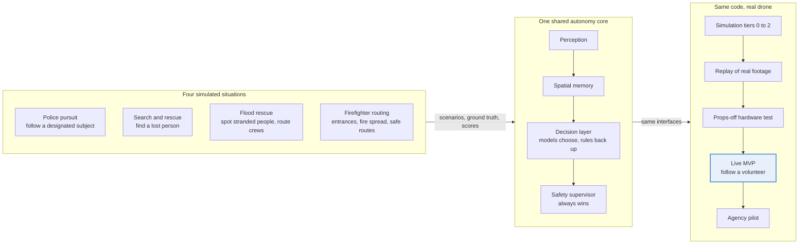

## The four situations at a glance

| Situation | What is simulated | What the drone does | Headline measure |
|---|---|---|---|
| Police pursuit | Streets, alleys, yards and cover; a subject who walks, runs, hides and blends in; officers on foot | Follows at a standoff, finds the subject again after cover, reports movement history | Time the subject stays in view; identity swaps (target 0) |
| Search and rescue | Park or forest with terrain and canopy; a lost person who wanders or shelters; decoys; day and night | Searches sectors by probability, confirms with a second look, guides a team in | Time to first confirmed find, against a plain lawnmower sweep |
| Flood rescue | A neighborhood with rising water, closing roads, people on roofs and cars, debris, radio reports | Sweeps, triages every sighting, routes crews around flooding | People reached by a crew; nobody closed without a human look |
| Firefighter routing | A building with doors and windows on sides A to D, spreading fire, drifting smoke, wind shifts | Maps openings and their condition, keeps crew routes safe, sends reroute alerts | Route margin never below the limit; entrances found |

## What makes it different

- **Answers, not video.** Measured statements to the person on foot and to command, with the error bound attached.
- **Bounded autonomy.** Models pick from short lists of safe actions; code and a safety supervisor have the last
  word.
- **Simulation first.** Four worlds with ground truth, so every change is measured before it flies.
- **Vendor-neutral.** One interface for the simulator, DJI drones (through a phone bridge) and PX4 drones (through
  MAVSDK).

## Why now

- As of February 2026, over 1,000 public-safety agencies held FAA waivers for drone-as-first-responder programs
  ([EFF, July 2026](https://tagteam.harvard.edu/hub_feeds/2036/feed_items/18572388)).
- Hardware makers sell aircraft and video to the pilot. The [Skydio R10](https://uavcoach.com/skydio-r10-f10/)
  (September 2025, 785 g, up to 20 min per battery) and the [BRINC LEMUR 2](https://uavcoach.com/brinc-lemur-2/)
  (March 2023, real-time LiDAR floor plans) are built for indoor and tactical flight. Neither is a cross-mission
  decision layer that briefs the responder on foot.
- Decision models now answer typed questions fast enough to sit in the loop: OpenAI Decisions answers Overwatch's
  questions in about 0.2 s median.

## What already works (in simulation)

- A 26-scenario suite in which all 17 scenarios with a pass criterion pass (the other 9 are measurement-only).
- A live decision layer: OpenAI Decisions (gpt-6-luna) at about 185 to 200 ms median, with an 800 ms deadline and a
  rules fallback. In the loss-recovery scenario S16 the model scored 6 of 6 against the rules' 3 of 6, after one
  wording revision.
- A MuJoCo model of a Skydio X2 flown by the decision layer in 3D, with a 250 Hz attitude controller whose motors
  saturate only 0.3% of the time.
- Ground-position error of 0.15 to 0.3 m median with marker calibration, and 0.7 to 1.0 m with telemetry alone. The
  subject stayed in frame 100% of the time in the 5 m/s follow scenario (OW3).
- Voice alerts through ElevenLabs with a local fallback, and 69 backend tests.
- **Written, not yet on hardware:** an iPhone bridge app for a DJI Mini 2 (DJI MSDK 4.16.2) and a responder iPhone
  app that uses LiDAR.

## What we reuse

From the 27 projects screened (repo by repo in [section 6](#6-what-we-use-from-every-repo)):

1. **jev-drone and Jev Reflex Autonomy Lab (MIT):** a tactical obstacle-maneuver decision, measured outcomes for each
   option, and a cutoff for stale answers.
2. **AERIS flight safety (BSD-3) and DronePi (Apache-2.0):** fault detection and flight watchdogs, needed before any
   real flight.
3. **multi-robot-coverage (MIT) and ResQ Viz (Apache-2.0):** search coverage, sector assignment and a fleet view.
4. **EchoRescue, ember, FlyBy, FloodRescue and FireSight (no license that allows copying):** ideas we rebuild:
   energy-gated return, fire-spread hazards, triage queues, cut-off areas and building reconstruction.
5. **DroneOS (Apache-2.0 in part):** a dispatch incident model, plus its PX4 offboard handshake as a reference.

## The ask

- **A partner training site:** a police or fire training ground where volunteers can play subjects and a training
  building can be orbited.
- **Aircraft:** the DJI Mini 2 kit our bridge targets, and a PX4 development quadcopter with a depth camera and an
  onboard computer.
- **People:** a Part 107 pilot on every flight, plus an officer and a fire officer who review what the system says.
- **Feedback:** two or three agencies willing to tell us which statements they would act on and which they would
  ignore.

---

# Part 2: The detailed plan

## 1. What the finished system does

At the end, a dispatcher can turn a call into a drone mission, and the drone carries it out on its own inside hard
limits. People approve anything that sends a crew or changes who is being followed.

| Area | The finished system | Today |
|---|---|---|
| Missions | Follow a designated subject; search an area; sweep a flood zone and triage sightings; map a building's openings and keep crew routes safe; follow indoors on a scanned building (research) | **Built:** Follow. **Planned:** the rest |
| Perception | People and vehicles from above; tracking through camera motion; clothing-based re-identification within one incident; thermal targets; doors, windows and debris by name; second-look confirmation | **Built:** detector, tracker with camera-motion compensation, re-identification gallery, marker calibration. **Planned:** thermal, open-vocabulary objects, second look |
| Spatial memory | One calibrated map holding tracks, subject trails, a probability-of-presence map, water and fire hazard layers, and a 3D building model (a Gaussian splat for people to look at, an occupancy map for flight) | **Built:** metric map, Kalman tracks, LiDAR occupancy grid. **Planned:** trails, probability map, hazards, 3D model |
| Decisions | Eleven typed decision tasks (D1 to D11), each answered by a model from a short option list, with per-task confidence gates, a rules fallback and a shadow comparison on every call | **Built:** D1 to D5, OpenAI Decisions live, rules, gates, shadow comparison. **Written:** Jev adapter (needs a key). **Planned:** D6 to D11, a local model |
| Autonomy | Follow, search patterns, orbit, inspect and return; several drones splitting sectors and handing off when one runs low | **Built:** follow and the re-acquire state machine. **Planned:** the rest |
| Safety | Speed, altitude and geofence limits; never directly over people; fault detection; energy-gated return; obstacle reflex; watchdogs; E-STOP and pilot override | **Built:** limits, geofence checked 1.5 s ahead, people check, battery return, E-STOP. **Written:** bridge watchdogs. **Planned:** faults, energy gate, reflex |
| Aircraft | One interface for the simulator, DJI drones through a phone bridge, PX4 drones through MAVSDK, and replay | **Built:** MuJoCo X2, simulated bridge, replay. **Written:** DJI Mini 2 bridge. **Planned:** PX4 |
| People | Operations console, 3D command view, responder phone with voice and haptics, dispatch intake from calls, voice or text commands, after-action replay | **Built:** console, 3D view, voice alerts. **Written:** responder app. **Planned:** intake, commands |
| Simulation and evaluation | Four situation worlds with ground truth, a batch runner with seeds and baselines, scored reports, optional photoreal sensor tests | **Built:** 26-scenario suite, replay, scoring. **Planned:** the four worlds, batch baselines |

## 2. Use cases

Every use case runs on the same core. The tables list the mission pack it uses and the simulated situation it is
trained in.

### Police

| ID | Use case | What the drone does | What people get | Mission | Trained in |
|---|---|---|---|---|---|
| P1 | Follow a designated subject | Holds a 12 m standoff at 18 m altitude, keeps the subject framed, finds them again after cover | Live position relative to each officer: clock bearing, range, closing speed | Follow | Police pursuit |
| P2 | Movement history | Keeps a timed trail, splits it into legs and stops, matches it to streets | "Since tagged 4 min ago: 380 m north-east along Elm St, stopped 40 s behind 412, now running east" | Follow | Police pursuit |
| P3 | Lost-subject search | Picks a bounded search move from the last-seen point and nearby cover (D1), widens to a perimeter, hands off after 20 s | Suggested perimeter points; time since loss | Follow | Police pursuit |
| P4 | Officer-safety overwatch | Watches people near an officer on foot | "Closing fast" alerts by haptics and voice | Follow | Police pursuit |
| P5 | Building entry and exit | Marks where a subject entered a building and watches the other exits | "Entered 412 by the side door 30 s ago; north exit in view" | Follow | Police pursuit |
| P6 | Indoor clearing on a scanned building (later) | Flies inside on a prior 3D model and follows the subject | The subject's room and path on the 3D model | Indoor | Research, after the four situations |

### Search and rescue

| ID | Use case | What the drone does | What people get | Mission | Trained in |
|---|---|---|---|---|---|
| S1 | Probability-guided search | Searches sectors in order of probability per second of travel | Coverage map; probability still unsearched | Search | Search and rescue |
| S2 | Several drones, one area | Splits sectors evenly and reassigns them when a drone fails or runs low | Who covers what; where the gaps are | Search | Search and rescue |
| S3 | Night thermal search | Sweeps with thermal; warm objects become flags | A ranked queue of flags with confidence | Search | Search and rescue (night) |
| S4 | Confirm before alerting | Revisits uncertain flags from a second angle | Fewer false alerts reaching people | Search | Search and rescue, flood rescue |
| S5 | Guide the ground team | Holds over the find and reports bearing and distance to the team | "Person 2 o'clock, 140 m, past the creek" | Follow (static subject) | Search and rescue |

### Flood rescue

| ID | Use case | What the drone does | What people get | Mission | Trained in |
|---|---|---|---|---|---|
| F1 | Sweep for stranded people | Flies lanes over flooded blocks and revisits likely people first | Ranked sightings: roof, car, tree | Flood | Flood rescue |
| F2 | One-click triage | Gives each sighting an action, an urgency and a likelihood (D7); unsure ones go to a person | Approve or override in one click; nothing is closed silently | Flood | Flood rescue |
| F3 | Cut-off areas and crew routes | Tracks water level and road closures; computes reachable areas and routes | "Oak Park block newly cut off"; route options for boats and ground crews | Flood | Flood rescue |
| F4 | Rising-water watch | Re-checks known people as the water rises | "Water at roofline at 3 locations" | Flood | Flood rescue |
| F5 | Drop a flotation aid (later, hardware dependent) | Hovers over a confirmed person and releases a payload | Confirmation of delivery | Flood | Flood rescue (later) |

### Fire

| ID | Use case | What the drone does | What people get | Mission | Trained in |
|---|---|---|---|---|---|
| R1 | Entrance map by side | Orbits the building at two heights; finds doors, windows, stairs and roof hatches; names them by side A to D | A labeled building model: "Side C: two doors" | Fire | Firefighter routing |
| R2 | Opening condition | Checks each opening with thermal and visual cameras (D11) | "Side C left door clear and cool; side B basement window venting smoke" | Fire | Firefighter routing |
| R3 | Safe approach routes | Computes routes with the time before fire reaches each segment; D9 picks one and explains it | A route with its safety margin | Fire | Firefighter routing |
| R4 | Reroute alerts | Recomputes margins as the fire spreads or the wind shifts | "Route 2 margin under 5 min; use route 3" | Fire | Firefighter routing |
| R5 | Crew position overwatch (opt-in) | Tracks designated crews relative to the fire edge | "Engine 3 crew 60 m from the fire edge, closing" | Follow (several subjects) | Firefighter routing |

### Across all agencies

| ID | Use case | What the drone does | What people get | Mission | Trained in |
|---|---|---|---|---|---|
| X1 | Dispatch to mission | Turns a call or CAD incident into a proposed mission and drone: code ranks, D10 proposes, a person approves | A mission proposal with its reasons | All | All four |
| X2 | Voice or text commands | Turns "survey the back of the house" into a proposed sequence of primitives | The plan, shown before it flies | All | All four |
| X3 | After-action review | Records every frame, decision and override so the mission can be replayed | Exact replay and an audit trail | All | All four |
| X4 | Training | Runs the situations with an agency's own maps | Scored exercises | All | All four |

### End to end: a pursuit call

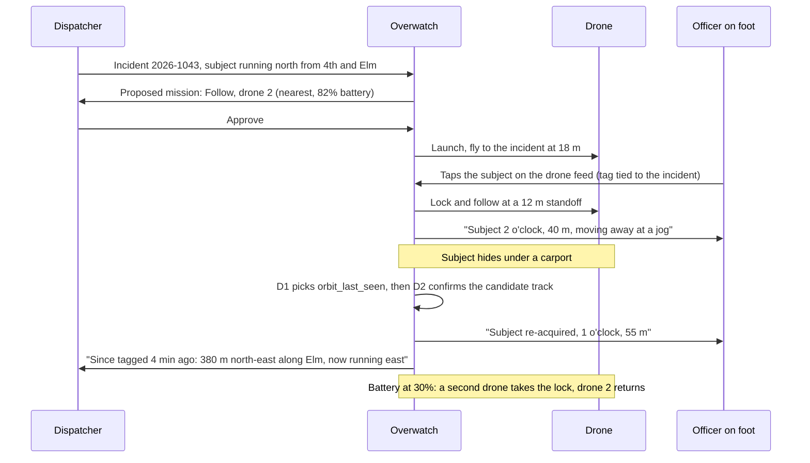

## 3. Simulation program: the four situations

### 3.1 Why simulation first

Real emergencies cannot be rehearsed safely or repeatably. Simulations can, thousands of times, with ground truth
for every frame. Every behavior in Overwatch is tested in simulation, against ground truth and against a rules
baseline on the same random seeds, before it flies. The same code runs in simulation and on the real aircraft; only
the aircraft adapter changes.

### 3.2 Four fidelity tiers

```mermaid
flowchart LR
  T0["Tier 0: batch runs<br/>kinematic drones, synthetic detections"] -->|"beats the rules baseline"| T1["Tier 1: physics and 3D<br/>MuJoCo X2, rendered camera"]
  T1 -->|"every safety scenario passes"| T2["Tier 2: autopilot in the loop<br/>PX4 SITL and Gazebo via MAVSDK"]
  T2 -->|"no command outside limits"| T3["Tier 3, optional: photoreal<br/>Isaac Sim with Pegasus, or Project AirSim"]
  T3 -->|"detectors hold on realistic images"| HW["Real aircraft<br/>DJI simulator props off, then the field"]
```

| Tier | What runs | What it tests | Status |
|---|---|---|---|
| 0. Batch runs | Kinematic drones, grid or road-graph worlds, synthetic detections from noise models; thousands of seeded runs | Decision prompts, gates, triage thresholds, sector allocation, routing | Partly built (scenario runner, rules baselines) |
| 1. Physics and 3D | MuJoCo Skydio X2 with a 250 Hz attitude loop, rendered drone camera, animated people, three.js 3D view | Perception, tracking, follow control, safety rules | **Built** (26 scenarios; OW7 in 3D) |
| 2. Autopilot in the loop | PX4 software-in-the-loop with Gazebo, driven through MAVSDK | Real flight modes, failsafes, offboard timing | Planned |
| 3. Photoreal sensors (optional) | Isaac Sim with Pegasus, or Project AirSim; splats of real places as backgrounds | Whether detectors trained on synthetic images hold up on realistic ones | Optional |
| Real aircraft | DJI simulator with the real bridge app, props off; then the field | The whole system, for real | Bridge **written** |

### 3.3 One scenario contract

Every scenario, in every situation and tier, is one file: the world, the people and their behaviors, hazards,
sensors, injected faults, a timeline, and the expected metrics with pass thresholds. A seed makes it repeatable.
Today's 26 scenarios already work this way; the four situations extend the format to 3D worlds.

```yaml
id: PP3
situation: police_pursuit
title: Subject hides under a carport, then runs
seed: 3107
world:
  map: procedural            # or a real neighborhood from OpenStreetMap footprints
  blocks: 5
  occluders: [carport_a, oak_row_2]
  lighting: dusk
actors:
  subject:
    designated_by: officer_1  # the tag is tied to an incident
    behavior: evasive         # walk, run, stop, hide, double back
    route: [gate_3, alley_2, carport_a, yard_12]
    hide_s: [8, 15]           # hides for 8 to 15 s
  lookalikes: 1
  officers: [{id: officer_1, phone: true}]
drone:
  aircraft: mujoco_x2
  standoff_m: 12
  altitude_m: 18
faults:
  - {t: 40, kind: frame_drop_burst, duration_s: 2}
  - {t: 55, kind: wind_gust, mps: 6}
expected:
  subject_in_view_fraction: {min: 0.85}
  reacquire_after_hide_s: {max: 10}
  identity_swaps: {max: 0}
  safety_violations: {max: 0}
```

### 3.4 What "training" means here

- **Decision layer.** Each task's model answers are compared with the rules baseline on identical seeds. We tune how
  the state is written, each task's confidence gate, and when a model is asked at all. Writing state as sentences
  matters: FlyBy found a decision model's accuracy on 20 cases rose from 0.25 with raw JSON to 0.75 with plain prose.
- **Optional local model.** A small local decision model can be fine-tuned on simulator-labeled states so decisions
  keep working without a network. FlyBy's attempt shows the limit: fine-tuning only helps when the information the
  decision needs is in the input.
- **Perception.** The renderer labels every pixel, so detectors (people from above, thermal targets, doors and
  windows) can be pre-trained on synthetic images, then checked on real footage before they are trusted.
- **Control and safety.** Gains, standoff, wind response and fault responses are tuned in physics. Every safety rule
  has a scenario that tries to break it.
- **Not trained.** There is no end-to-end learned flight policy. Models never output stick commands.

### 3.5 What gets randomized

| Category | Randomized |
|---|---|
| Light and weather | Time of day, night, rain, fog or smoke density, wind and gusts |
| Sensors | Camera noise and blur, frame drops, latency, GPS error, compass error, link loss |
| People | Counts, routes, speeds, hiding times, clothing (to create look-alikes), behavior profiles |
| World | Occluder density, building layouts, decoys, water rise rate, fire ignition point and fuel |
| Aircraft | Battery capacity, motor faults, wind response |
| Services | Decision API outages, rate limits, slow answers |

### 3.6 Police pursuit

**Goal.** Train and prove the Follow mission: keep a designated person in view through streets, cover and
look-alikes, and report how they move.

**World and 3D models.**
- Four to six suburban blocks with streets, alleys, fenced yards, trees, carports and parked cars.
- Layouts are either generated or taken from OpenStreetMap building footprints of a real neighborhood.
- The 3D view uses Kenney CC0 models (suburban buildings, cars, trees, characters). MuJoCo gets simple boxes and
  cylinders for collisions, and tree canopies are marked as camera occluders.
- Day, dusk and night lighting.

**People and their behavior.**
- **Subject:** a behavior model with states walk (1.2 to 1.6 m/s), jog (2.5 to 3.5 m/s), sprint (up to 6 m/s), stop,
  hide (under cover for a set time), double back, enter a building and exit another door. In evasive mode, the
  choices are biased toward cover and away from the drone.
- **Look-alikes:** pedestrians with similar clothing colors who cross the subject's path, to set identity-swap traps.
- **Officers:** officers on foot carry simulated phones (pose, LiDAR) and receive alerts.
- **Vehicles:** cars move on the streets as occluders and distractions.

**Sensors and faults.** The drone camera runs up to 15 fps with a gimbal. Faults include GPS noise, wind gusts, frame
drops, link loss and decision API outages. The responder phone supplies pose and LiDAR.

**Mission flow.**

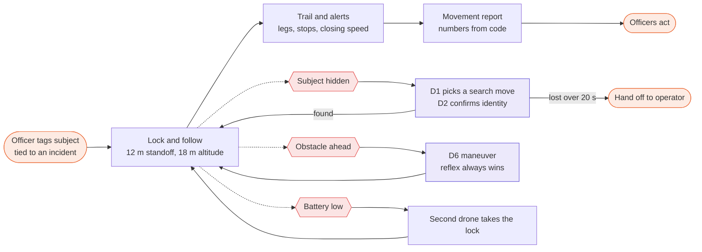

If the subject outruns the speed caps (follow at most 4 m/s, re-acquire at most 6 m/s), the drone climbs to widen
its view and reports the last direction rather than chasing faster.

**Decisions used.** D1 search move after a loss, D2 identity of a candidate, D4 motion label, D5 which alert to speak,
and the new D6 obstacle maneuver.

**Scenarios.**

| ID | Scenario | What it tests | Builds on today's |
|---|---|---|---|
| PP1 | Walk and turn corners on open streets | Baseline follow and framing | OW3, S02 |
| PP2 | Sprint, then cut through a yard | Speed step, caps, climb and widen | OW1, OW3 |
| PP3 | Hide under a carport or tree for 8 to 15 s | Loss, D1 search move, re-acquire | OW2, OW7 |
| PP4 | A look-alike crosses paths | Identity, never switch when unsure | OW4 |
| PP5 | Enter a building and exit another door | Entry report, watching exits | S04 |
| PP6 | Gets into a car | Stay inside limits, report direction, hand off | none (new) |
| PP7 | Wind gusts and frame drops during a sprint | Robustness | OW6 |
| PP8 | Decision API outage mid-pursuit | Rules fallback with no gap | S15 |
| PP9 | Battery low mid-pursuit | Second drone takes the lock | none (new) |
| PP10 | Officer approaches the subject | Closing-speed alerts to the officer | OW1, OW5 |

**Metrics and targets.**

| Metric | Target | Measured today |
|---|---|---|
| Subject in view during follow on open streets | 90% or more | 100% in OW3 (5 m/s exit) |
| Ground-position error of the trail | 1 m or less median with telemetry calibration | 0.7 to 1.0 m median (OW2, OW3) |
| Re-acquire after a 3 to 5 s occlusion | within 10 s | measured per run in OW2 and OW7 |
| Identity swaps | 0 | 0 wrong-target steps in OW4 |
| Safety violations (over people, geofence, clearance) | 0 | 0 |

**Reused from repos.** jev-drone (D6, path reflex, stale-answer cutoff), Jev Reflex Autonomy Lab (measured option
outcomes and criteria), XRDrone (projection validity reasons), Counter-UAS (gated filter idea), DroneOS (dispatch
incident model).

**Built today.** OW1 to OW7 (walk, sprint, tree occlusion, 5 m/s exit, look-alike crossing, gusts with frame drops,
decision-driven search with the MuJoCo X2) and S02 to S05.
**To build.** A street-network world, the subject behavior model, trail legs and reports, D6, and a second drone.

### 3.7 Search and rescue

**Goal.** Train and prove the Search mission: cover an area in the order a person is most likely to be found,
confirm before alerting, and guide a team in.

**World and 3D models.**
- One to two square kilometres of park or forest with trails, clearings and a creek.
- Hills come from a heightmap, and a canopy-density map hides people from the camera.
- The 3D view uses Kenney CC0 nature models; MuJoCo gets terrain and tree-trunk collisions.
- Day and night.

**People and their behavior.**
- **Lost people:** one or more are placed from a last-known point, with a travel distance that grows with elapsed
  time. A time-scaled radius ring is the first placeholder; real lost-person statistics replace it later.
- **Behavior profiles:** stay put, wander, follow trails, move downhill, or seek shelter. A person may be responsive
  (moving or waving) or still.
- **Decoys:** animals, warm rocks, debris and dropped clothing.
- **Ground teams:** they move on the trails.

**Sensors and faults.**
- Visual and simulated thermal cameras: body heat against a background whose temperature depends on time of day,
  attenuated under canopy.
- Faults: wind, GPS error, link loss at range.
- Battery drain that depends on speed and wind.

**Mission flow.**

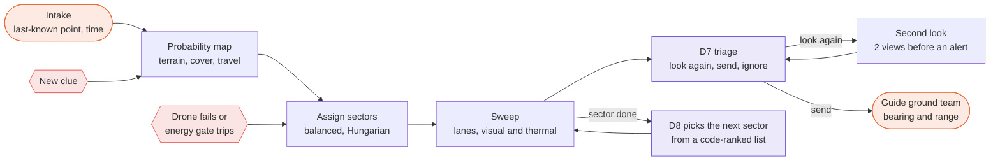

**Decisions used.** D7 triage of each flag, D8 next sector from code-ranked candidates, and D1 and D2 when guiding a
team to a person who is moving.

**Scenarios.**

| ID | Scenario | What it tests |
|---|---|---|
| SR1 | Responsive person in a clearing, daytime | Baseline search and guidance |
| SR2 | Person under canopy, partly visible | Probability ordering, second look |
| SR3 | Night thermal search with animal decoys | Thermal flags, false-alert control |
| SR4 | Person walking along a trail away from the last-known point | Prior that grows with time, moving target |
| SR5 | Two drones; one fails mid-mission | Sector reallocation |
| SR6 | Long search limited by battery | Energy-gated return and handoff |
| SR7 | New clue mid-search (a found backpack) | Re-weighting the probability map |
| SR8 | Warm rocks that look like people | Second look before alerting |

**Metrics and targets.**

| Metric | Target |
|---|---|
| Time to first confirmed find | faster than a plain lawnmower sweep on the same seeds |
| Probability covered after 30 minutes | higher than the lawnmower baseline |
| False alerts reaching a person | fewer than without second looks |
| Battery at landing | always above the reserve |
| Geofence or collision events | 0 |

**Reused from repos.** multi-robot-coverage (coverage code), ResQ Viz (routes), EchoRescue (energy gate, frontier
scoring, evidence before alerting), optimized-drone-search (probability prior, greedy pick), aeronavefinal2 (balanced
split, second look), skyeye (search radius ring), sar-drone-intelligence (cell-scoring structure).

**Built today.** Occupancy grid, tracker, decision router.
**To build.** A terrain world, thermal rendering, the probability map, the coverage planner, D7, D8 and the energy
gate.

### 3.8 Flood rescue

**Goal.** Train and prove the Flood mission: find people stranded by water, rank every sighting for one-click
approval, and route crews around flooded roads as the water rises.

**World and 3D models.**
- A low-lying neighborhood with houses, cars and trees.
- A water surface whose level rises on a scripted timeline.
- A road graph with elevations, so roads close as water covers them.
- The 3D view uses Kenney CC0 suburban, car and boat models, and the water is an animated plane at the current level.

**People and objects.**
- **Stranded people:** on roofs, in cars, in trees, or wading. A person is "at risk" when the water comes within a
  set height of where they stand.
- **Decoys:** debris and floating objects.
- **Crews:** boats travel on water and ground crews on dry roads.
- **Reports:** radio and phone reports arrive over time; some are wrong and later retracted. A language model parses
  each into fields, and code merges them into the incident picture, as FlyBy does.

**Sensors and faults.** Visual and thermal cameras with water glare, rain and wind; GPS error; patchy comms.

**Mission flow.**

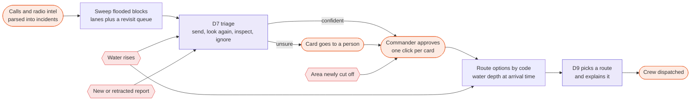

**Decisions used.** D7 triage (send a crew, look again, inspect close, ignore, plus urgency and likelihood), D9 route
choice among code-computed routes, D10 dispatch proposal, and D5 alert priority.

**Scenarios.**

| ID | Scenario | What it tests |
|---|---|---|
| FR1 | Daytime sweep, people on roofs | Baseline sweep and triage |
| FR2 | People in cars and trees, with debris decoys | Triage under clutter |
| FR3 | Water rising toward a person on a low roof | Urgency raised, re-triage |
| FR4 | A road floods while a crew is en route | Route recomputed at arrival time |
| FR5 | A wrong radio report, then a retraction | Leads re-decided |
| FR6 | Rain and glare degrade detection | More second looks, no silent closes |
| FR7 | Many flags at once | Commander workload |
| FR8 | A neighborhood is newly cut off | Reachability alert |

**Metrics and targets.**

| Metric | Target |
|---|---|
| People reached by a crew | more than the rules baseline on the same seeds |
| Time from first sighting to crew | lower than the rules baseline |
| Real people closed without any human look | 0 |
| Routes that hit a flooded road at arrival time | 0 |
| Cards per hour for the commander | reported (workload) |

**Reused from repos.** FlyBy (triage lifecycle and thresholds, sweep with visits, intel merge, words versus numbers),
FloodRescue (newly cut-off areas), flood-ops (call intake), ember (time-aware route safety), la-hacks-2026
(hazard-penalized routing).

**Built today.** Decision router, alert arbiter, recording.
**To build.** The water model, the road graph, the triage queue in the console, D7, D9 and D10.

### 3.9 Firefighter routing

**Goal.** Train and prove the Fire mission: map the ways into a building by side, watch the fire spread, and keep
crew routes safe, with reroute alerts when margins shrink.

**World and 3D models.**
- A block with a target building whose doors, windows, garage, stairs and roof hatch are modeled on sides A to D
  (A is the address side, then clockwise), plus neighboring houses, hydrants and streets.
- A wildland-edge variant adds vegetation fuel.
- Real buildings can be captured as Gaussian splats (video, then COLMAP, then Nerfstudio splatfacto) to make the 3D
  view photoreal. The splat is for people to look at; flight uses the simple collision geometry.

**Dynamics.**
- **Fire:** spread is computed as arrival times over a grid with wind, slope and fuel, using a shortest-path method
  (ember's approach), with simplified room-by-room spread inside.
- **Smoke:** smoke plumes drift with the wind. They blind the visual camera along the line of sight and add hot gas
  to the thermal image.
- **Openings:** each opening moves through the states closed, open, venting and blocked.

**People.** Designated crews (opt-in) move to entrances; occupants appear at windows; vehicles arrive.

**Sensors and faults.** Visual and thermal cameras, smoke occlusion, wind shifts, GPS error.

**Mission flow.**

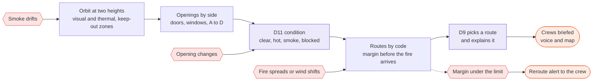

**Decisions used.** D11 condition of each opening, D9 route choice among code-computed routes with fire margins, and
D5 alert priority.

**Scenarios.**

| ID | Scenario | What it tests |
|---|---|---|
| FF1 | House fire on a clear day | Orbit, openings by side |
| FF2 | Smoke drift hides side C | Keep-out zones, re-planned viewpoint |
| FF3 | Wind shift | Arrival times change, reroute alert |
| FF4 | An opening becomes blocked | Condition re-check |
| FF5 | An occupant at a window | Flagged to command at once |
| FF6 | Wildland edge with fire approaching homes | Route margins over a wider area |
| FF7 | Sun on a metal roof reads as hot | Second look before alerting |
| FF8 | A crew heads down a route whose margin is dropping | Alert-time target |

**Metrics and targets.**

| Metric | Target |
|---|---|
| Visible openings found (recall) and correct (precision) | 0.9 or more each |
| Openings placed on the right side | all of those found |
| Route margin (time before fire arrival) when a route is recommended | never below the set minimum |
| Reroute alert after a margin drops below the limit | within 5 s |
| Drone inside a smoke or heat keep-out zone | 0 |

**Reused from repos.** ember (fire spread, route safety, attack-zone scoring), la-hacks-2026 (hazard routing),
FireSight (reconstruction recipe), DronePi (LiDAR sectors, mesh tools), fyrdup (rules-first assignment pattern).

**Built today.** Occupancy grid and fusion.
**To build.** A building generator with openings, the fire and smoke model, thermal rendering, opening detection, D9
and D11.

### 3.10 Building the 3D worlds

One seeded scene spec generates everything a run needs, so the physics, the camera images, the 3D view and the scoring
always agree.

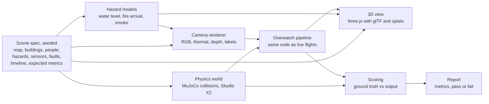

| Asset | Source | License | Used for |
|---|---|---|---|
| Drone model | Skydio X2 from MuJoCo Menagerie (already vendored in `backend/third_party/skydio_x2`) | Apache-2.0 | Physics and the 3D view |
| Buildings, cars, boats, trees, people, props | Kenney asset packs | CC0 | 3D view and renderer |
| Real street layouts and building footprints | OpenStreetMap | ODbL (attribution) | Pursuit and flood worlds |
| Terrain | Heightmaps (public elevation data or generated) | depends on source | Search and rescue world |
| Real buildings | Gaussian splats we capture (COLMAP, then Nerfstudio splatfacto) | BSD and Apache-2.0 tools | Fire world, command view |
| Splats in the browser | GaussianSplats3D for three.js | MIT | 3D view |
| People animation | Overwatch's renderer (walking actors) and Kenney characters | ours, CC0 | Renderer and 3D view |

**Rendering notes.** Thermal images come from a temperature per material plus noise, scaled to grayscale. Depth and
segmentation come from the same render pass, so every pixel has a label. Smoke is a fog density along the line of
sight; water uses an animated plane at the current level.

## 4. Architecture and data flow

### 4.1 Layers

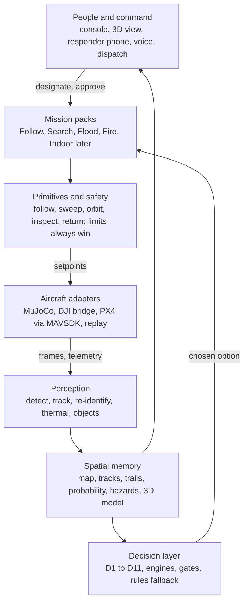

| Layer | Built | Next |
|---|---|---|
| People and command | Operations console, 3D decision view, ElevenLabs voice alerts; responder iPhone app written | Dispatch intake, voice or text commands, fleet view, after-action replay page |
| Mission packs | Follow (lock, standoff follow, re-acquire, handoff) | Search, Flood sweep and triage, Fire structure and routing; Indoor later |
| Decision layer | D1 to D5, OpenAI Decisions live, rules fallback, confidence gates, shadow comparison | D6 to D11, Jev and a local model as engines, measured option outcomes, stale-answer cutoff |
| Spatial memory | Calibrated metric map, Kalman tracks, LiDAR occupancy grid, subject locks with a re-identification gallery | Subject trails, probability map, water and fire layers, 3D building model |
| Perception | YOLO26 or simulated detector, tracker with camera-motion compensation, ArUco calibration, phone LiDAR sectors | Thermal detection, open-vocabulary objects, second-look confirmation |
| Primitives and safety | Follow, re-acquire moves, speed, altitude and geofence caps, never over people, battery return, E-STOP, pilot override | Sweep, orbit, inspect; fault detection, energy-gated return, setpoint watchdog, obstacle reflex |
| Aircraft adapters | MuJoCo Skydio X2, simulated bridge, recorded replay; DJI Mini 2 bridge written | PX4 via MAVSDK (SITL first, then a real quadcopter); ArduPilot later |

### 4.2 Data flow and rates

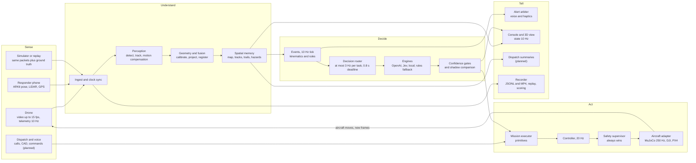

| Loop | Rate | Where |
|---|---|---|
| Drone physics and attitude control (simulation) | 250 Hz | `sim/mujoco_drone.py` |
| Autonomy and virtual-stick commands | 20 Hz, each command expires after 300 ms | `autonomy/controller.py`, bridge app |
| Perception (drone video) | up to 15 fps | pipeline |
| Kinematics, rules and events | 10 Hz tick | pipeline |
| Decisions | at most 3 Hz per task, 800 ms deadline | `decisions/router.py` |
| Telemetry from the DJI bridge | 10 Hz | iOS bridge app |
| State to the console | 10 Hz | `/ws/state` |
| 3D view frames | 20 Hz | `/ws/sim3d` |

| Channel | Carries |
|---|---|
| `/ws/bridge` | Drone video (H.264 or JPEG) and telemetry up; bounded commands down |
| `/ws/phone` | Responder pose, LiDAR sectors, person boxes up; alerts down |
| `/ws/video/*` | Binary JPEG frames with overlay headers that match each exact frame |
| `/ws/state`, `/ws/events`, `/ws/alerts` | World state, events and alerts for the console and responder page |
| `/ws/sim3d` | Drone pose, rotor thrusts, actors and decisions for the 3D view |

### 4.3 Decision layer

Every decision is a typed question with a short list of options. The rules baseline answers the same question every
time; a model's answer is used only if it arrives in time and clears that task's confidence gate.

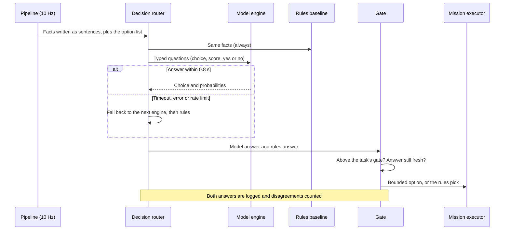

**Rules in force today.** 800 ms deadline; at most 3 decisions per second per task; default confidence gate 0.70,
identity 0.75, and D1 search moves 0.50 (a wrong pick costs search time, not safety). A D1 choice is held for 3 s,
and an answer below the gate flies the rules' pick. Images are not sent to models by default. Planned additions are
an age cutoff (drop answers older than 1.5 s), a session tag so a restart never applies old answers, and validation
of probability distributions.

| Task | Question | Options (bounded) | Rules baseline | Status |
|---|---|---|---|---|
| D1 Re-acquire | Which search move after the subject is lost? | continue along the last velocity, scan left, scan right, climb and widen, orbit the last-seen point, hold and alert | by loss duration and where the prediction lies | **Built** |
| D2 Identity | Does a candidate track continue the subject? | each candidate, or none | appearance and motion score | **Built** |
| D3 Description | Which person matches a spoken description? | each candidate, or none | attribute match | **Built** |
| D4 Motion | What is the subject's observable motion? | stationary, walking, running, approaching, moving away, crossing | speed and heading thresholds | **Built** |
| D5 Alert priority | Which non-urgent alert should be spoken now? | each pending alert, or none | severity, then age | **Built** (urgent alerts never wait for a model) |
| D6 Obstacle maneuver | How to get past an obstacle ahead? | hold course, steer left, steer right, climb, back off | steer toward the wider side | Planned (from jev-drone) |
| D7 Lead triage | What to do with a possible person? | send a crew, look again, inspect close, ignore; plus urgency and likelihood | detector band and context | Planned (from FlyBy) |
| D8 Next sector | Which sector to search next? | top candidates ranked by code | most probability per second of travel | Planned |
| D9 Route choice | Which route should a crew take? | routes computed by code, each with its margin | largest safety margin | Planned (ember method) |
| D10 Dispatch proposal | Which mission and drone for an incident? | drones and mission packs ranked by code | nearest capable drone | Planned (DroneOS model) |
| D11 Opening condition | Is this door or window usable? | clear, hot, smoke, blocked, unknown | thermal and visual thresholds | Planned |

| Engine | Status |
|---|---|
| OpenAI Decisions (gpt-6-luna) | **Built**, live: about 185 to 200 ms median; a cold first call took about 1.3 s, so the service warms up first |
| TypeSafe Jev (jev-latest, `/v1/systemone`) | **Written**: adapter exists, needs a key |
| Strands | **Written**: adapter exists, needs a local server |
| Local model (Laya-style, same choice, score and yes-or-no question format) | Planned: an offline engine between the cloud models and the rules |
| Rules | **Built**: always answers, always logged |

### 4.4 Safety in depth

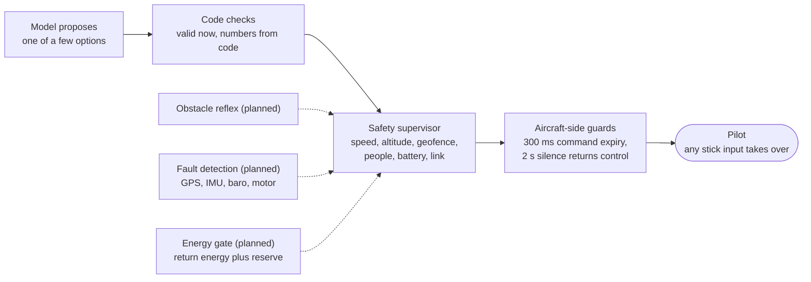

| Limit (defaults in `config.py`) | Value |
|---|---|
| Follow standoff and altitude | 12 m horizontal, 18 m up (floor 12 m, ceiling 60 m) |
| Speed caps | follow 4 m/s, re-acquire 6 m/s, vertical 1.5 m/s, yaw 45°/s |
| Tilt cap (MuJoCo controller) | 25° |
| Geofence | checked 1.5 s ahead; outward motion removed |
| People | never directly over a person (3 m radius) |
| Battery | warning at 30%, return at 20% (energy gate planned) |
| Commands | 20 Hz; each expires after 300 ms, and the aircraft hovers |
| Link | after 2 s of backend silence the bridge leaves virtual stick and the pilot is in control |
| Real flight | off unless `autonomy.allow_real_flight` is set **and** the operator arms it |
| Subject lock | requires an incident |

### 4.5 Aircraft adapters

| Adapter | Status | Control | Telemetry | Notes |
|---|---|---|---|---|
| MuJoCo Skydio X2 | **Built** | Velocity commands into a geometric attitude controller at 250 Hz | Full state, rotor thrusts | Used by OW7 and the 3D view |
| Simulated bridge | **Built** | Same messages as the DJI bridge | Same as the DJI bridge | Runs the whole stack without hardware |
| DJI Mini 2 bridge (iPhone, DJI MSDK 4.16.2) | **Written**, not run on hardware | Virtual stick at 20 Hz, 300 ms expiry, 2 s silence returns control, caps, E-STOP, return home | 10 Hz telemetry, raw H.264 video (JPEG fallback) | DJI simulator, props off, comes first |
| PX4 via MAVSDK | Planned | Offboard body velocity at 10 to 20 Hz, zero-velocity watchdog | Position, heading, velocity, battery, mode, armed state | PX4 SITL with Gazebo first; PX4 geofence as a second line |
| ArduPilot via pymavlink | Later | Guided-mode velocity targets | MAVLink telemetry | Same interface |
| Replay | **Built** | None | Recorded | Deterministic re-runs for scoring |

## 5. Tech stack

| Layer | In use today | Planned additions | License notes |
|---|---|---|---|
| Backend | Python 3.12, FastAPI, uvicorn, pydantic v2, numpy, OpenCV, PyAV, httpx | scipy (Hungarian assignment, Dijkstra) | scipy is BSD-3 |
| Perception | Ultralytics YOLO26 or simulated detector; in-repo ByteTrack-style tracker with camera-motion compensation; ArUco | Thermal detector; open-vocabulary detector (Grounding DINO or OWLv2); detector training on synthetic images | Ultralytics is AGPL-3.0 unless commercially licensed; Grounding DINO and OWLv2 are Apache-2.0 |
| Simulation | MuJoCo with the Skydio X2, in-repo camera renderer, 26-scenario runner | Four situation worlds; PX4 SITL with Gazebo; optional Isaac Sim with Pegasus or Project AirSim | MuJoCo, Menagerie and Gazebo are Apache-2.0; PX4 is BSD-3; check the photoreal options' licenses |
| Decisions | OpenAI Decisions (gpt-6-luna); rules; Jev and Strands adapters | D6 to D11; a local model | API terms |
| Planning | Re-acquire state machine, occupancy grid | Coverage planner, A*, probability map, route options | multi-robot-coverage code is MIT |
| Flight | DJI MSDK 4.16.2 bridge app in Swift | MAVSDK-Python adapter for PX4 | MAVSDK is BSD-3 |
| Phone | iOS in Swift: ARKit and LiDAR, Vision, speech, haptics | none | |
| Voice | ElevenLabs text-to-speech with account fallback; browser and iOS speech as local fallbacks | Voice or text commands | API terms |
| Dashboard | React 19, Vite 7, Tailwind 4, Zustand, three.js | Fleet view, triage queue, geographic map (MapLibre GL JS), splats (GaussianSplats3D) | three.js and GaussianSplats3D are MIT; MapLibre is BSD-3 |
| Maps and 3D assets | Local metric map | OpenStreetMap layouts, Kenney models, heightmaps, captured splats | OSM is ODbL; Kenney is CC0 |
| Reconstruction | none | COLMAP, then Nerfstudio splatfacto | COLMAP is BSD; Nerfstudio is Apache-2.0; some research models (for example MASt3R) are non-commercial only |
| Data and replay | JSONL and MP4 recording, deterministic replay, WebSockets | Batch result store for seed-paired comparisons | |
| Testing | pytest (69 tests), scenario runner (26 scenarios) | Batch baselines per situation | |

## 6. What we use from every repo

All 27 repos were cloned and read; nothing from them was run. "What it is" is judged from the code, not the README.
**Copy** means the license lets us copy code with its notice; **rebuild** means we reimplement the idea; **skip**
means nothing worth taking.

### 6.1 How the 27 map onto Overwatch

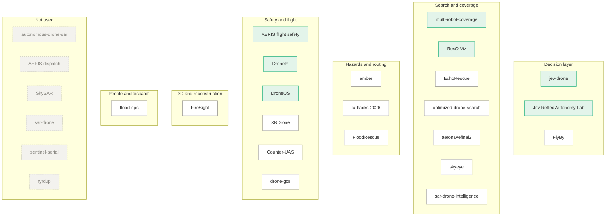

Green: copy or port code. White: rebuild the idea. Gray: not used.

### 6.2 Repo by repo

| # | Repo · license | What it is | What we take | Where it lands | How | Situations |
|---|---|---|---|---|---|---|
| 1 | [FlyBy](https://github.com/monishramj/flyby) · none | HackGT 13 flood-triage simulation: a noise-model detector, local Laya decisions, Grok intel, a fly-eye collision reflex | Triage lifecycle with two thresholds (a person below 0.50 confidence; auto-close only at 0.60 or more); a sweep with visits that pause it; intel merged into an incident picture by code; state written as sentences; "the model writes words, code writes numbers" | D7 triage, Flood and Search packs, decision prompts, report writer | Rebuild | Flood, SAR |
| 2 | [jev-drone](https://github.com/RomanSlack/jev-drone) · MIT | MuJoCo X2 follows a rover past obstacles; Jev picks maneuvers at up to 3 Hz | Symbolic depth scene (5 range sectors, free space above, level and below); maneuver rubric with aircraft capabilities; commit window; climb veto; 2.2 m path reflex; ignore answers older than 1.5 s; run metrics (furthest progress, % visible, % time in reflex) | D6, reflex in the safety layer, router, scenario metrics | Copy | Pursuit, Fire |
| 3 | [Jev Reflex Autonomy Lab](https://github.com/khordoo/jev-reflex-autonomy-lab) · MIT | 2D browser simulation; up to 15 point-mass drones each ask Jev for one of 7 actions | Measured outcome for each option; criteria written as effect, choose when, reject when; recent-action memory; probability validation; a session counter that drops old answers | Decision types, engines and router (all tasks) | Copy | All |
| 4 | [multi-robot-coverage](https://github.com/Shadysiam/multi-robot-coverage) · MIT | ROS 2 and numpy coverage algorithms with 47 tests | Boustrophedon decomposition; lawnmower paths per cell; Hungarian assignment with workload balance; reallocation when a robot fails; frontier exploration; A* with obstacle inflation | New coverage planner | Copy | SAR, Flood |
| 5 | [ResQ Viz](https://github.com/resq-software/viz) · Apache-2.0 | ASP.NET and three.js multi-drone operator console with a 60 Hz simulation | Lawnmower and strip-per-drone routes (about 40 lines to port); drone, hazard and detection message shapes; minimap rules (shape shows type, color shows state, stale contacts change shape); keyframe-plus-delta streaming; control leases and command idempotency (idea) | Coverage planner, schemas, fleet view | Copy (port from C#) | SAR, Flood |
| 6 | [EchoRescue](https://github.com/oleszik/ECHORESCUE) · all rights reserved | Grid search-and-rescue simulator with A*, frontiers, energy and multi-drone roles; ROS 2 and ArduPilot SITL layer; 50-seed benchmarks | Energy-gated steps (plan home from the next cell, go only if return energy plus reserve remains); frontier information-gain scoring; a task registry that reassigns a failed drone's work; evidence with hysteresis and 2 or more views | Safety (energy gate), coverage, alert confirmation | Rebuild (license forbids copying) | SAR, Flood |
| 7 | [optimized-drone-search](https://github.com/ashwin-builds/optimized-drone-search) · none | Monte Carlo campus search simulator on OpenStreetMap footprints | Probability prior with peaks and basins; probability left per basin; greedy pick of the cell with the most probability per second of travel | Probability map, D8 candidates | Rebuild | SAR |
| 8 | [aeronavefinal2](https://github.com/imaliabedin/aeronavefinal2) · none | Unity WebGL indoor multi-drone rescue with a local YOLO-World person detector | Balanced sector split (shift cost offsets until counts are within 2%); work stealing by idle drones; confirmation from 2 or more viewpoints at 0.92 confidence; coverage counted only from processed frames | Multi-drone allocation, confirmation, coverage accounting | Rebuild (C#) | SAR, Indoor later |
| 9 | [skyeye](https://github.com/defAaron/skyeye) · none | Flask and React: tiled YOLOv8n on drone photos, language-model intake | Lost-person radius ring scaled by elapsed time (placeholder for real statistics); sliding-window tiling for small people | Probability prior seed, detector tiling | Rebuild | SAR |
| 10 | [sar-drone-intelligence](https://github.com/Total-Helix/sar-drone-intelligence) · MIT | FastAPI app whose vision, flight and detections are mocks | Structure of per-cell scoring (distance decay from the last-known point, terrain attractors, travel direction); its demographic modifiers are dropped | Probability map | Adapt the structure | SAR |
| 11 | [ember](https://github.com/RayHCai/ember) · none | Multi-service wildfire system with a Cesium dashboard, swarm runtime and planner | Fire arrival times by Dijkstra over a wind, slope and dryness grid; route safety that drops roads the fire reaches first; attack-zone scoring; Hungarian tile assignment; Cesium hazard layers (idea) | Fire hazard layer, D9 route options, sector assignment | Rebuild | Fire, Flood |
| 12 | [la-hacks-2026](https://github.com/vaibhavhariram/la-hacks-2026) · none | FastAPI hazards with OSMnx A* routing and a Cesium viewer | Hazard-penalized A* with distance bands; field-report parser with a regex fallback | Route options, intel parsing fallback | Rebuild | Fire, Flood |
| 13 | [FloodRescue](https://github.com/priyalgupta776-ux/FloodRescue) · none | Sentinel-1 flood mapping and road reachability | "Newly cut-off" areas: multi-source Dijkstra from hospitals before and after flooding | Flood reachability layer | Rebuild | Flood |
| 14 | [flood-ops](https://github.com/trunghafromvietnam/flood-ops) · none | FastAPI incident system with phone-call intake and a MapLibre console | Call webhook with a signature check, idempotent incident ids and background geocoding | Dispatch intake (X1) | Rebuild | Flood, all |
| 15 | [FireSight](https://github.com/yuhtuna/FireSight) · none | FastAPI driving Nerfstudio (COLMAP, then splatfacto); its analysis numbers are mocked | Reconstruction job runner with progress parsing and a COLMAP retry ladder | Fire world capture, Structure pack 3D model | Rebuild the recipe | Fire |
| 16 | [fyrdup](https://github.com/mhtruong1031/fyrdup) · Apache-2.0 per README, no LICENSE file | ROS 2 and Gazebo wildfire cellular automaton with ground robots | Rules first, a model only for ambiguous cases (a pattern we already use); seeding a fire map from an aerial image (idea) | Fire scenario seeding (idea) | Mostly skip; ember is stronger | Fire |
| 17 | [AERIS flight safety](https://github.com/Official-John/AERIS) · BSD-3 | Numpy fault-injection simulator with a detect, confirm, diagnose and recover supervisor; 43 tests | Detectors (timeout, stuck, CUSUM); M-of-N confirmation; fault signature diagnosis; recovery chosen by remaining capability; GPS versus vision residual checks | New health module beside the safety supervisor | Copy | All, before real flight |
| 18 | [DronePi-Autonomous-Mapping](https://github.com/Xavier-Nieves/DronePi-Autonomous-Mapping) · Apache-2.0 | PX4 and MAVROS on a Raspberry Pi 5 with LiDAR mapping | Offboard-loss pause and return; setpoint watchdog; erratic-motion detector; GPS quality gate; 3-zone LiDAR sectors; post-flight mesh tools | Safety supervisor, PX4 adapter, building capture | Port the logic | All, Fire |
| 19 | [DroneOS](https://github.com/ortegarod/drone-os) · Apache-2.0, flight core marked proprietary | PX4 and ROS 2 SDK with a language-model dispatch agent | PX4 offboard handshake as reference; telemetry checklist; dispatch incident types, locations and state machine with an arrival monitor (from the Apache-2.0 files) | PX4 adapter design, dispatch intake | Port dispatch; core as reference only | Pursuit, all |
| 20 | [XRDrone](https://github.com/XRDrone/XRDrone) · MIT | DJI Neo video through ArUco or ORB-SLAM3 to a ground-plane projection | Stale-pose gating; a ground projection that reports why it is invalid | Geometry status fields | Adapt | Pursuit |
| 21 | [Counter-UAS](https://github.com/hilariie/Counter-UAS) · GPL-3.0 | AirSim, a mock radar, YOLO and a per-track EKF | Gated filter with a sensor mask and re-initialization after repeated rejects | Tracker robustness | Idea only (GPL) | Pursuit |
| 22 | [drone-gcs](https://github.com/lluisestape-upc/drone-gcs) · GPL-3.0 | Electron ground station over rosbridge for ArduCopter | MAVLink bridge with heartbeat and reconnect | Future ArduPilot adapter | Idea only (GPL) | none yet |
| 23 | [autonomous-drone-sar](https://github.com/Nihara-D/autonomous-drone-sar) · none | ArduCopter SITL demo through DroneKit; broken as shipped | Nothing beyond a trivial grid generator | none | Skip | none |
| 24 | [AERIS (dispatch)](https://github.com/Jeffuz/AERIS) · none | Video upload, YOLO and language-model triage colors; mostly a mock dashboard; commits credentials | The idea of a typed triage decision with a rules fallback (already part of D7) | none | Skip | none |
| 25 | [SkySAR](https://github.com/Alfonso3435/SkySAR) · MIT | One Streamlit file sending frames to Gemini; exposes what looks like an API key | Nothing | none | Skip | none |
| 26 | [sar-drone](https://github.com/anusha-balamurali/sar-drone) · none | ROS 2 lawnmower with color detection snapped to known victim positions | Nothing | none | Skip | none |
| 27 | [sentinel-aerial](https://github.com/Ferousco-dev/sentinel-aerial) · MIT | Toy-drone video, YOLO, pixel zones, Telegram alerts | Video reconnect with backoff (minor) | Live video source | Minor | none |

Six more projects named in the survey that prompted this screening (Drone Command Center, BOSCO, Caligo Dynamics,
SOAR, SaR 3D, Guardian Eye / RAVEN) had no source code we could verify, so nothing is taken from them.

### 6.3 Integration order

| # | Feature | Source | Lands in Overwatch | Code or idea | Effort |
|---|---|---|---|---|---|
| 1 | Decision hygiene: drop answers older than 1.5 s, tag answers with a session counter, validate probabilities, use D1's "likely occluded" answer | jev-drone `run.py:163`; Jev Reflex `controller.ts:295-312`, `validation.ts` | `pipeline.py`, `decisions/router.py`, `engines.py` | Code (MIT) | Small |
| 2 | Options with measured outcomes and effect, choose-when and reject-when criteria; every task's state written as sentences | Jev Reflex `action-projection.ts`, `jev-server.ts:92-144`; FlyBy `render()` | `decisions/types.py`, `tasks.py` | Code (MIT), idea | Small |
| 3 | D6 obstacle maneuver: symbolic depth scene, maneuver rubric, commit window, climb veto, path reflex | jev-drone `flight.py:233-353`, `tactics.py:17-101`, `run.py:161-218` | `decisions/tasks.py`, a scene builder in `sim/`, `autonomy/controller.py`, `safety.py` | Code (MIT) | Medium |
| 4 | Sensor-fault detection: detectors, M-of-N confirmation, signature diagnosis, recovery by capability | AERIS flight safety `aeris/core/` (269 lines) | New `autonomy/health.py`; today `faults.py` only injects faults | Code (BSD-3) | Medium |
| 5 | Supervisor upgrades: offboard-loss pause, setpoint watchdog, erratic-motion detector, GPS quality gate | DronePi `safe_flight_mixin.py:455-870`, `gps_reader.py:717-747` | `autonomy/safety.py` | Port (Apache-2.0) | Medium |
| 6 | Energy-gated return | EchoRescue `simulation.py:489-566` | `autonomy/safety.py` over `geometry/occupancy.py`, replacing the fixed battery threshold | Idea | Medium |
| 7 | Search coverage: boustrophedon cells, lawnmower paths, Hungarian sector assignment, failed-drone reallocation, frontier scoring | multi-robot-coverage `boustrophedon.py`, `frontier_based.py`, `astar.py`; ResQ Viz `SwarmCoordinator.cs:290-352`; EchoRescue frontier scoring | New `autonomy/coverage.py` and the Search pack | Code (MIT, Apache-2.0), idea | Medium |
| 8 | Confirm before alerting: second look from 2 or more viewpoints, evidence with hysteresis | EchoRescue `perception.py:112-245`; aeronavefinal2 `RescueMission.cs:673-725` | `events/rules.py` | Idea | Small |
| 9 | PX4 adapter over MAVSDK with offboard velocity streaming | Our own code; DroneOS handshake as reference | New `sim/px4_drone.py` | Our own code | Medium |
| 10 | Dispatch intake: incident types, state machine, arrival monitor, phone-call webhook | DroneOS `dispatch/`; flood-ops `voice/webhook.py` | New `overwatch/dispatch/` | Code (Apache-2.0), idea | Medium |
| 11 | Fleet view: drone, hazard and detection message shapes; minimap rules | ResQ Viz `Models/VizFrame.cs:51-76`, `client/miniMap.ts` | `schemas.py`, a new dashboard component | Code (Apache-2.0) | Medium |
| 12 | Fire hazards: arrival-time spread and route safety | ember `planner/spread.py`, `civilians.py` | New hazards module | Idea | Medium |
| 13 | Building reconstruction job: COLMAP, then splatfacto, with a retry ladder | FireSight `backend/main.py` | Fire world and Structure pack service | Idea | Large |

Items 1 and 2 improve every existing decision and are the cheapest. Items 3 to 6 close the safety gaps a real flight
would hit first.

### 6.4 Frameworks we build on

| Framework | Use | Status | License |
|---|---|---|---|
| MuJoCo | Flight physics | In use | Apache-2.0 |
| Skydio X2 (MuJoCo Menagerie) | Drone model | In use, vendored | Apache-2.0 |
| three.js | 3D view | In use | MIT |
| Ultralytics YOLO | Detection | In use | AGPL-3.0, or a commercial license |
| PX4 Autopilot | Autopilot, SITL and real | Planned | BSD-3 |
| MAVSDK | Backend to PX4 | Planned | BSD-3 |
| Gazebo | PX4 SITL worlds | Planned | Apache-2.0 |
| ArduPilot | Alternative autopilot | Later | GPL-3.0 (runs as a separate process over MAVLink) |
| QGroundControl | Reference ground station for pilots | Reference | Apache-2.0 or GPL-3.0 (dual) |
| Kenney asset packs | 3D models | Planned | CC0 |
| OpenStreetMap | Street layouts and footprints | Planned | ODbL |
| MapLibre GL JS | Geographic map | Planned | BSD-3 |
| CesiumJS | City-scale 3D | Optional | Apache-2.0 |
| COLMAP and Nerfstudio | Building capture | Planned | BSD and Apache-2.0 |
| GaussianSplats3D | Splats in the browser | Planned | MIT |
| OpenDroneMap | Post-flight orthophotos | Not now | AGPL-3.0 |
| Isaac Sim with Pegasus, Project AirSim | Photoreal sensors | Optional | Check before use |

### 6.5 Licenses in short

- 13 of the 27 repos have a license: 11 permissive (DroneOS only in part) and 2 copyleft (GPL-3.0). A repo with no
  LICENSE file is all rights reserved, even when its README names a license.
- **Copy with the notice kept:** jev-drone, Jev Reflex Autonomy Lab, multi-robot-coverage (MIT); ResQ Viz, DronePi,
  DroneOS outside `src/drone_core` (Apache-2.0, also noting changes); AERIS flight safety (BSD-3).
- **Ideas only:** everything else, including EchoRescue, whose license explicitly forbids copying, and the GPL repos.
- Copied code keeps its upstream LICENSE in `third_party/`, as Overwatch already does for the Skydio X2 model.
- SkySAR and AERIS (dispatch) commit what look like live keys. We did not use them and should tell the authors.

## 7. Live MVP: follow a volunteer

### 7.1 What the flight proves

The first real flight is deliberately small. One drone follows one volunteer across an open field, with a licensed
pilot ready to take over. It proves that the same code that passes the pursuit scenarios in simulation can lock,
follow, lose and find a real person, report their path accurately, and never break a safety rule.

### 7.2 Field setup

```text
+--------------------------------------------------------------------------+
| OPEN FIELD (landowner permission)                                         |
|  + - - - - - - - - - - - - - - - - - - - - - - - - - - - - - - - - - +  |
|  :  GEOFENCE, set inside the field edge                                :  |
|  :                                                                     :  |
|  :      (V) start . . . walk . . . . [TREE or SHELTER] . . . jog . .>  :  |
|  :                         .            hidden for 3 to 5 s            :  |
|  :          (L) look-alike walker crosses here                         :  |
|  :                                                                     :  |
|  :      (D) drone: 12 m horizontal standoff, 18 m up,                  :  |
|  :          never directly over anyone, at most 4 m/s                  :  |
|  + - - - - - - - - - - - - - - - - - - - - - - - - - - - - - - - - - +  |
|  [P] pilot and launch point, laptop running Overwatch, safety observer   |
+--------------------------------------------------------------------------+
   spectators stay behind this line
```

### 7.3 Hardware options

| | Option A: DJI (ready to test) | Option B: PX4 (more open) |
|---|---|---|
| Aircraft | DJI Mini 2 with the RC-N1 controller | PX4 development quadcopter with a camera and an onboard computer |
| Link to Overwatch | iPhone running OverwatchDroneBridge (DJI MSDK 4.16.2) | MAVSDK adapter on the laptop or the onboard computer |
| Control | Virtual stick at 20 Hz; 300 ms expiry; 2 s silence returns control | Offboard body velocity at 10 to 20 Hz; zero-velocity watchdog; PX4 failsafes |
| First test | DJI simulator, props off, with the real app | PX4 SITL with Gazebo, then a tethered hover |
| Status | **Written**, not yet run on hardware | Planned |
| Trade-off | Fastest to a stable video feed; closed autopilot | Full control and logs; more setup work |

In both options the laptop runs the Overwatch backend and console, and an observer carries the responder iPhone app
(**written**) to receive alerts.

### 7.4 Test sequence

Each step must pass before the next one starts.

1. **Props-off DJI simulator run** with the real bridge app. Pass: telemetry, video and commands work; every limit
   holds; pilot stick input always takes over.
2. **Tracking only, pilot flying.** The pilot hovers and moves the drone by hand while Overwatch tracks and reports.
   Pass: the lock holds and the trail matches the volunteer's phone GPS log within the stated error bound.
3. **Assisted follow at walking pace.** Virtual stick on, pilot's hands on the sticks. Pass: the 12 m standoff holds
   and nothing breaks a limit.
4. **Occlusion.** The volunteer walks behind a tree or shelter for 3 to 5 s. Pass: D1 picks a search move and the
   drone re-acquires within the target.
5. **Look-alike.** A second, similarly dressed walker crosses the path. Pass: no identity swap.
6. **Speed step.** The volunteer jogs. Pass: the drone stays within its caps, climbing to widen the view if needed.
7. **Report check.** Compare the movement history with the GPS log. Pass: legs and stops match.

### 7.5 Targets

| Measure | Target | Matching simulation scenario |
|---|---|---|
| Subject in frame during follow | 90% or more of follow time | PP1, OW3 |
| Re-acquire after a 3 to 5 s occlusion | within 10 s | PP3, OW2 |
| Identity swaps with a look-alike | 0 | PP4, OW4 |
| Trail error against the volunteer's GPS log | within the combined error bound (phone GPS plus calibration) | PP1 |
| Safety violations | 0 | all |
| Overrides | all logged and replayable | all |

### 7.6 Field demo script, after the gates pass (about 90 seconds)

The pitch demo is the simulation (see "What the demo shows" in Part 1). This script is for the later field flight.

| Time | What judges see |
|---|---|
| 0:00 | The console: incident created; the officer taps the volunteer on the drone feed; the lock badge turns green |
| 0:15 | The drone follows at 12 m; the responder phone says "Subject 2 o'clock, 15 m, walking away" |
| 0:35 | The volunteer hides behind the tree; the decision card shows D1's choice, its confidence and the rules' pick |
| 0:45 | Re-acquired; D2 confirms identity while the look-alike walks past |
| 1:00 | The volunteer jogs; the drone climbs to widen its view instead of exceeding its speed cap |
| 1:15 | The movement report appears with numbers from code, overlaid on the GPS log |
| 1:25 | The pilot moves a stick; control returns instantly and the override is logged |

### 7.7 Not in the MVP

No flight over people, no night flight, no flight beyond line of sight, no indoor flight, no vehicles, and no
autonomous takeoff or landing on the DJI path: the pilot launches and lands.

## 8. Roadmap and gates

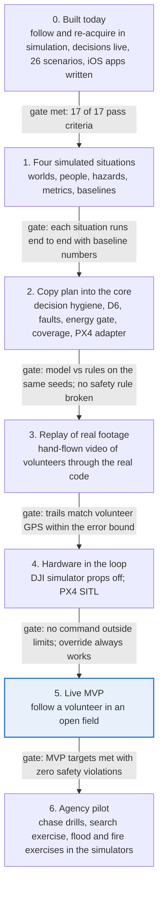

| Phase | Delivers | Size |
|---|---|---|
| 0. Built today | Follow in simulation, decision layer, 26-scenario suite, iOS apps written | Done |
| 1. Four simulated situations | Worlds, actors, hazards and scenario sets PP, SR, FR and FF with baselines | Largest step; the pursuit world comes first because the MVP depends on it |
| 2. Copy plan into the core | Integration items 1 to 9 in section 6.3 | Medium steps |
| 3. Replay of real footage | Recorded volunteer footage scored against GPS logs | Small |
| 4. Hardware in the loop | Props-off DJI simulator and PX4 SITL runs | Small to medium |
| 5. Live MVP | The flight in section 7 | Small, once gates pass |
| 6. Agency pilot | Exercises with a partner agency | Depends on the partner |

## 9. How we measure

- **Same seeds, two answers.** Every model decision is compared with the rules baseline on identical seeds, and in
  live runs both answers are logged (shadow mode) and disagreements counted.
- **Measured claims only.** A number appears in a report only if a run produced it; metric statements are suppressed
  when calibration or freshness checks fail.
- **Score what matters.** FlyBy first counted "braked before contact" and got 29 of 63; scored as "braked in time"
  it was 7. jev-drone's headline result rests on a single run. Our gates use the stricter measure and many seeds.
- **Ground truth from the simulator, GPS logs in the field.** Each situation's metrics come from its scenario files;
  the MVP compares against the volunteer's phone GPS.
- **Fail loudly.** Every scenario has an expected-metrics block; the suite reports pass, fail or measurement-only per
  scenario.

## 10. Guardrails

- **People designate, the system never does.** Only an officer can tag a subject, and the tag needs an incident.
  The system reports motion facts (range, speed, heading, path) and never labels intent or threat.
- **No face recognition and no lasting identity.** Re-identification uses clothing appearance within one incident;
  the gallery is deleted when the incident closes.
- **Every decision is on the record.** Each model call, its confidence, and whether rules or a person overrode it is
  logged, and missions can be replayed exactly.
- **Bounded autonomy.** Models pick from fixed option lists, never stick commands. Limits sit below every mission and
  the pilot's stick always wins. Real flight needs an explicit setting plus operator arming.
- **No images to models by default.** Decisions use structured facts; sending images is an explicit setting.
- **Airspace and law.** Outdoor flights follow FAA Part 107 (line of sight, at most 400 ft above ground) and any
  agency waiver. Indoor flight is mostly outside FAA airspace rules, so department policy and the law on entering
  private spaces govern it.
- **Simulation is not certification.** Passing scenarios is evidence for the next step, not proof of flight safety.

## 11. Market and competition

As of February 2026, over 1,000 public-safety agencies held FAA waivers for drone-as-first-responder programs
([EFF, July 2026](https://tagteam.harvard.edu/hub_feeds/2036/feed_items/18572388)). Fire departments and volunteer
search-and-rescue teams fly the same aircraft. The buyers already fly drones; what they lack is the layer that turns
flights into answers.

| Product | What it is | What the user gets |
|---|---|---|
| [Skydio R10](https://uavcoach.com/skydio-r10-f10/) (September 2025) | 785 g indoor drone, up to 20 min per battery, obstacle avoidance in zero light | Live video from tight, dark spaces |
| [BRINC LEMUR 2](https://uavcoach.com/brinc-lemur-2/) (March 2023) | Tactical drone with LiDAR, thermal, and a hover that needs no GPS or light | Video plus a 2D floor plan built in real time |
| Hackathon projects (FlyBy, ember, EchoRescue and others in section 6) | Single-mission prototypes, mostly simulated | One mission each, often with mocked sensing |
| **Overwatch** | Software across aircraft, with mission packs, a decision layer and a simulation program | Measured statements: where the subject is relative to you, where they went, which way in, which route is safe |

Hardware makers sell aircraft and video to the pilot. Overwatch sells the layer above: one map across missions,
decisions with stated confidence, briefings delivered to the person on foot, and a simulator that proves each change.

## 12. Risks and mitigations

| Risk | Mitigation |
|---|---|
| Simulation-to-real gap in perception | Replay real footage before flying; domain randomization; optional photoreal tier; trust detectors only after real-footage checks |
| Model latency or outage | 800 ms deadline, rules fallback, planned local engine; urgent alerts never wait for a model |
| Identity swaps in crowds | Never switch when unsure; D2 with a 0.75 gate; operator confirmation; rebinds marked unverified |
| DJI Mini 2 virtual-stick behavior differs from the docs | Props-off DJI simulator first; the PX4 option as a fallback |
| Regulation | Part 107 pilot, line of sight, open fields first, partner agency waivers later |
| Civil-liberties concerns | Guardrails in section 10, audit logs, no face recognition, incident-bound tags |
| Licensing of borrowed code | Copy only MIT, Apache-2.0 and BSD code with notices; rebuild everything else |
| Scope of four situations | One shared scenario contract and asset pipeline; build pursuit first because the MVP depends on it |
| Overclaiming results | Measured-only reports, seed-paired baselines, stricter scoring |

## 13. Glossary

| Term | Meaning |
|---|---|
| DFR | Drone as first responder: a drone launched to a 911 call, often before officers arrive |
| Part 107 | The FAA rules for commercial small-drone flight in the US |
| SITL | Software in the loop: the real autopilot software flying a simulated aircraft |
| HIL | Hardware in the loop: real hardware (here, the DJI controller and app) flying in a simulator, props off |
| Offboard mode | PX4 mode in which an outside computer streams the setpoints |
| Virtual stick | DJI's interface for sending stick-like commands from an app |
| MAVLink, MAVSDK | The drone message protocol, and a library that speaks it |
| Camera-motion compensation | Removing the drone's own motion from the image before tracking |
| Re-identification | Recognizing the same person again from clothing appearance after a loss |
| Gaussian splat | A photoreal 3D model built from video, good for viewing but not for flight planning |
| Occupancy map | A grid of free and blocked space, used for planning flight paths |
| Boustrophedon | A back-and-forth sweep pattern over cells of an area |
| Hungarian algorithm | An optimal way to assign drones to sectors by cost |
| M-of-N confirmation | A fault counts only after M bad readings in the last N |
| CUSUM | A test that detects small, persistent drifts in a signal |

## 14. Sources

- EFF Deeplinks, "Hundreds of Drone-as-First-Responder Programs Could Soon Be Launched Across the Country," July 2026,
  [mirror](https://tagteam.harvard.edu/hub_feeds/2036/feed_items/18572388)
- UAV Coach, [Skydio Doubles Down on Public Safety with Launch of R10, F10](https://uavcoach.com/skydio-r10-f10/),
  September 2025
- Skydio, [From overwatch to entry: How Skydio R10 extends DFR indoors](https://www.skydio.com/blog/how-skydio-r10-extends-dfr-indoors),
  October 2025
- UAV Coach, [BRINC Launches the LEMUR 2](https://uavcoach.com/brinc-lemur-2/), March 2023
- [Splat-Nav: Safe Real-Time Robot Navigation in Gaussian Splatting Maps](https://arxiv.org/abs/2403.02751),
  arXiv 2403.02751 (planning and localization in splat maps; pose estimation at about 25 Hz ran on a desktop GPU over
  WiFi)
- The 27 repositories linked in section 6.2, cloned and read on 
- Overwatch: the scenario suite report of  (`evaluation/reports/run-132912`), `config.py`,
  `ios/README.md`, and the status report in `docs/report/`
